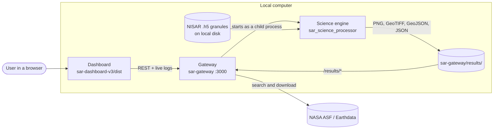
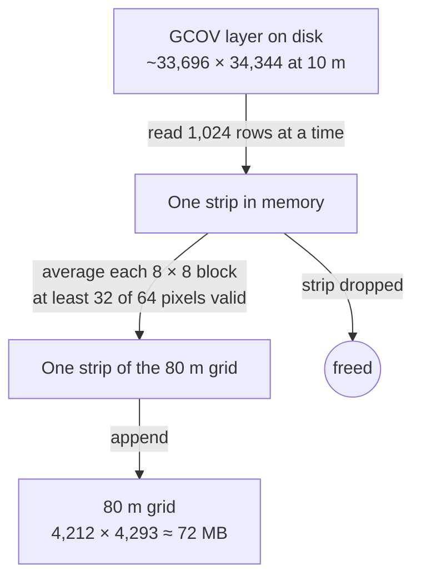
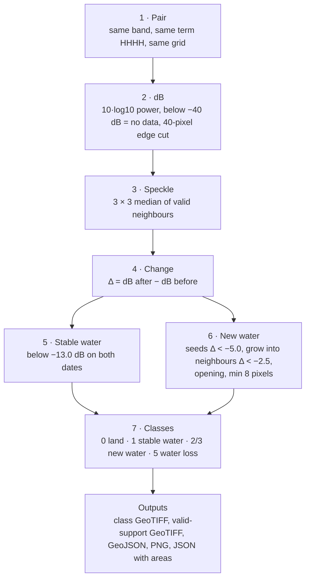
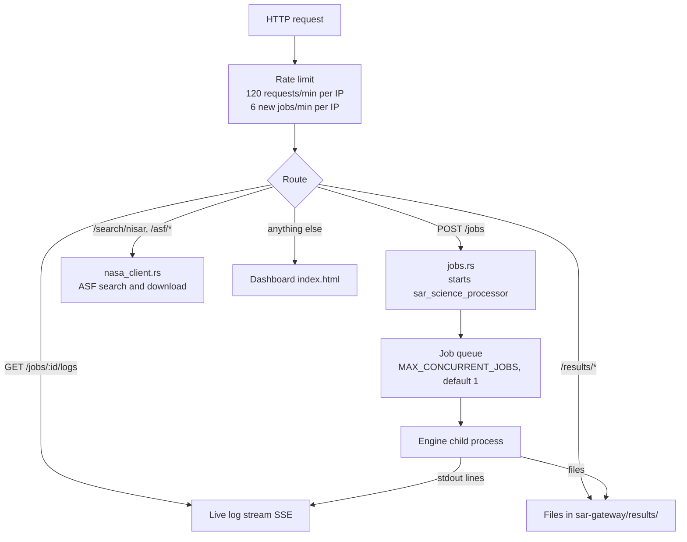
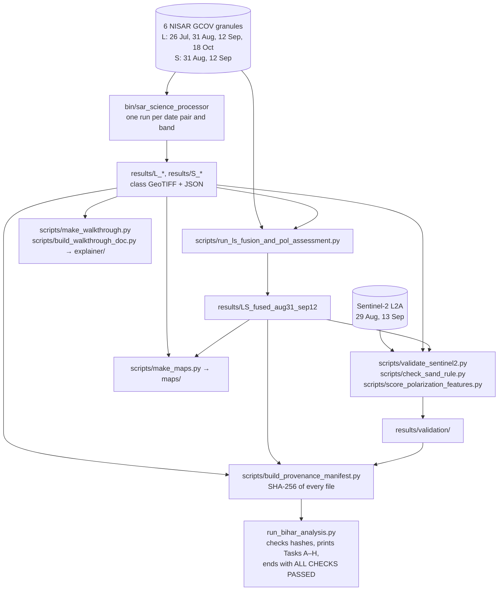
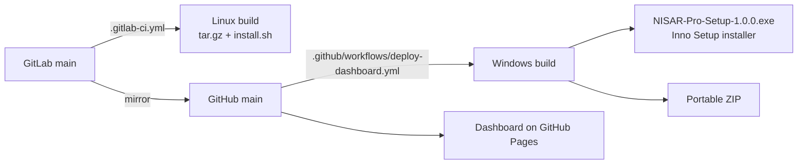

# NISAR Pro architecture

This page shows how the parts of NISAR Pro fit together. Everything here is taken from the
code in this repository (November 2026). Speeds and memory are the measured values from the
InGARSS 2026 runs.

---

## 1. The big picture

NISAR Pro has three programs and one hackathon package.

| Part | Folder | Language | Job |
|---|---|---|---|
| Science engine | `sar_science_processor/` | Rust | Reads NISAR `.h5` files and makes the water / change maps |
| Gateway | `sar-gateway/` | Rust (Axum, Tokio) | Web server on port 3000. Starts engine jobs, streams their logs, serves results and the dashboard |
| Dashboard | `sar-dashboard-v3/` | React + Vite + Leaflet | The web page: pick granules, run a job, look at the maps |
| Hackathon package | `ingarss_2026/` | Python (standard library for the checker) | Fusion, validation, maps and the reviewer checker for InGARSS 2026 |



All heavy work runs on the local computer. The radar files never leave it unless the user
sends them somewhere.

---

## 2. Science engine (`sar_science_processor`)

A command-line program. The gateway and the hackathon scripts both call it the same way.

| Mode | Flag | What it does |
|---|---|---|
| Flood / water change | `--mode flood` | Two GCOV dates → water and change classes (the InGARSS method) |
| GCOV image | `--mode gcov` | One GCOV date → a radar image |
| InSAR | `--mode insar` | Two SLC dates → interferogram, coherence, phase, ground movement |

Main source files:

| File | Job |
|---|---|
| `main.rs` | Reads the command-line flags and runs the chosen mode |
| `nisar_parser.rs` | Opens NISAR HDF5 files (pure-Rust `rustyhdf5` crate) and reads the grid and coordinates |
| `windowed.rs` | Reads a part of a big dataset without loading all of it |
| `multilook.rs` | Averages blocks of pixels |
| `flood_detect.rs` | The 7-stage water change method and Otsu |
| `io.rs` | Writes PNG, GeoTIFF (EPSG:32645), GeoJSON and the result JSON |
| `insar.rs`, `coregister.rs`, `deramp.rs`, `phase_filter.rs`, `unwrap.rs`, `topo_phase.rs`, `infra_health.rs` | InSAR path |
| `crash_journal.rs`, `sha256.rs`, `errors.rs` | Crash log, file hashes, error types |
| `src/bin/gcov_*.rs` | Small test tools that compare our HDF5 reads with h5py byte for byte (`scripts/nisar_probe.py`) |

### 2.1 How a full scene fits in memory

One GCOV layer is about 33,696 × 34,344 pixels (1.16 billion values, 4.63 GB as `f32`).
Loading two dates at once would need far more memory than a normal laptop has. So the
engine never loads a full layer.



Measured on a 4-core workstation: each date pair takes 44–65 s with 1.87–2.32 GB peak memory.

### 2.2 The flood path, step by step



S-band uses slightly different numbers (−12.5 dB stable water, −4.8 / −2.2 dB seed and
growth). Otsu is computed and reported, but the seed stays at −5 dB because
`seed = min(−5, Otsu, −3)`. Full details are in `ingarss_2026/TECHNICAL_NOTE.md`.

---

## 3. Gateway (`sar-gateway`)

An Axum web server on `0.0.0.0:3000`.



| File | Job |
|---|---|
| `main.rs` | Routes, CORS, serving the dashboard build, loading finished jobs on start |
| `handlers.rs` | One function per route |
| `jobs.rs` | Builds the engine command, runs it, keeps job status, cleans old jobs |
| `nasa_client.rs`, `esa_client.rs` | Catalogue search and downloads |
| `rate_limit.rs` | Per-IP request limits |
| `models.rs` | Request and response types |

Only the flood profile (`processor: "science"`) runs. The older `sar_processor` and the
Kubernetes operator `sar_operator_v2` were removed from the repository, so the gateway now
returns a clear error for the old InSAR and infrastructure profiles. The Kubernetes code path
in `jobs.rs` is only used when `LOCAL_MODE=false`, which no launcher sets.

---

## 4. Dashboard (`sar-dashboard-v3`)

React 19 + Vite. Built once with `npm run build`; the gateway then serves `dist/`, so Node is
not needed to use it.

| Folder | What is in it |
|---|---|
| `src/pages/marketing/` | Landing page |
| `src/pages/DocsPage.jsx` | Documentation pages |
| `src/pages/app/` | The working app: map, job form, flood replay, result panels |
| `src/config/` | Gateway address (`api.js`) |

Flood replay shows three steps: the before image, the after image, then the after image with
the class map on top.

---

## 5. InGARSS 2026 package (`ingarss_2026/`)

The package does not need the gateway or the dashboard. It calls the engine directly and
then runs Python scripts.



A reviewer only needs Python 3 and `python3 run_bihar_analysis.py`. No granules or downloads.

---

## 6. Release builds



The Windows app is installed per user (no admin needed) into
`%LOCALAPPDATA%\Programs\NISAR Pro`. It adds a Start Menu entry, an optional desktop icon and
an uninstaller. `NISAR Pro.exe` (from `installer/launcher.rs`) starts the gateway in the
background, waits for it, opens the dashboard, and shows a message box if something fails.
See `installer/README.md`.

---

## 7. Folder map

```
sar_analyzer/
├── sar_science_processor/   Rust science engine
├── sar-gateway/             Rust web server (port 3000)
├── sar-dashboard-v3/        React dashboard
├── ingarss_2026/            InGARSS 2026 submission package
├── installer/               Linux and Windows launchers, Windows installer script
├── scripts/                 Helper scripts (note PDF, tunnel, data download, h5py check)
├── Docs/                    Documentation
└── Download/                ASF bulk download script (no stored login)
```
