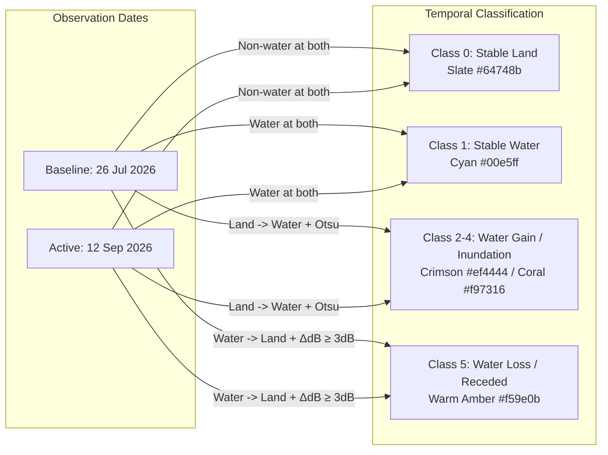

# NISAR Pro — Platform Architecture & Ecosystem Blueprint
> **Current Active Version**: Verified Production Pipeline for InGARSS 2026 Phase-1 Hackathon.
> **Scope**: Hybrid Edge-Cloud Topology, Dual Science Engines (Flood & InSAR), Hyperslab Streaming, and 4-Class Temporal Dynamics.

---

## 1. High-Level System Topology

NISAR Pro employs a **Hybrid Edge-Cloud Topology**. The control plane is delivered via an interactive web interface, while all heavy, CPU-bound SAR processing, HDF5 parsing, and spatial analytics execute on local hardware:

```mermaid
graph TD
    subgraph Frontend Control Plane [Frontend Web Dashboard: sar-dashboard-v3]
        Dashboard[React 19 + Vite Dashboard<br/>Leaflet Map + Dark Theme UI]
        FloodReplay[Flood Event Replay Controller<br/>Baseline -> Active -> Result]
        InsightsPanel[Flood Insight Panel<br/>4-Class Temporal Metrics: km² & ac]
    end

    subgraph Scientific Data Providers [Authoritative Data Streams]
        NASA_ASF[NASA ASF Vertex API<br/>NISAR L-band & S-band Granules]
        Local_NISAR[Local NISAR Storage<br/>/home/aditya/Desktop/nisar_data/]
    end

    subgraph Backend Microservice [Local Gateway: sar-gateway]
        Gateway[Rust Axum Server<br/>Port 3000 / Tokio Async]
        JobManager[Job Orchestrator<br/>jobs.rs / Process Spawner]
        Preloader[Historical Job Preloader<br/>Persistent Storage Ingestion]
        SSE[SSE Event Broadcaster<br/>Real-Time Log Streamer]
    end

    subgraph Science Compute Engine [Scientific Core: sar_science_processor]
        Reader[Streaming Chunked Reader<br/>ChunkedF32Reader / 1024-row Hyperslabs]
        Multilook[8x8 Integer Multilooker<br/>10m -> 80m Spacing Lattice]
        FloodEngine[7-Stage Flood Detection<br/>Otsu + 4-Class InGARSS Partition]
        InSAREngine[InSAR Deformation Engine<br/>Coherence SAT + Goldstein Filter]
        Exporter[Multi-Format Exporter<br/>RGBA PNG + GeoTIFF + GeoJSON]
    end

    %% Communication Flows
    Dashboard <-->|1. HTTP / REST API & SPA Fallback| Gateway
    Dashboard <-->|2. Server-Sent Events (SSE) Logs| SSE
    Gateway <-->|3. Preload & Serve Artifacts| Exporter
    JobManager -->|4. Spawns Subprocess CLI| Science Compute Engine
    Local_NISAR -->|5. Zero-Copy Hyperslab Reads| Reader
    Reader --> Multilook
    Multilook --> FloodEngine
    Multilook --> InSAREngine
    FloodEngine --> Exporter
    Exporter -->|6. Static File Service /results/*| Gateway
    Gateway -->|7. GeoJSON & Image Overlays| Dashboard
```

---

## 2. Dual Scientific Pipelines

NISAR Pro supports two independent, production-grade scientific processing pipelines:

```mermaid
graph TD
    InputData[Incoming Radar Dataset] --> ModeCheck{Processing Pipeline?}
    
    %% Pipeline 1: Flood
    ModeCheck -->|Mode: flood| FloodPipeline[InGARSS 2026 NISAR Flood Pipeline]
    subgraph Flood Pipeline [sar_science_processor --mode flood]
        F1[Raw GCOV Pair: Date 1 & Date 2] --> F2[Streaming Hyperslab Read: 1024 Rows]
        F2 --> F3[8x8 Multilooking: 1.157B -> 18.08M px]
        F3 --> F4[Speckle Filter: 3x3 Median]
        F4 --> F5[Log-Ratio Change: active_dB - baseline_dB]
        F5 --> F6[Otsu Threshold & Seeded Region Growing]
        F6 --> F7[InGARSS Section 6: 4-Class Partition]
        F7 --> F8[Artifacts: RGBA PNG, GeoJSON, Class TIFF, JSON Report]
    end

    %% Pipeline 2: InSAR
    ModeCheck -->|Mode: insar| InSARPipeline[Multi-Temporal InSAR Pipeline]
    subgraph InSAR Pipeline [sar_science_processor --mode insar]
        I1[Master & Slave SLC / GUNW] --> I2[Orbit State Vector Interpolation]
        I2 --> I3[2D FFT Cross-Correlation Coregistration]
        I3 --> I4[Interferogram Complex Conjugate]
        I4 --> I5[Coherence SAT Window Filtering]
        I5 --> I6[Adaptive Goldstein Spectral Filter]
        I6 --> I7[SNAPHU Phase Unwrapping]
        I7 --> I8[Line-of-Sight Displacement d = λφ / 4π]
    end
```



---

## 3. The 1.157 Billion Pixel Breakthrough Architecture

Handling full-scene NISAR swaths (e.g. the Ganga Alluvial Plain in Bihar: $33,696 \times 34,344$ pixels = 1.157 billion pixels per date) without running out of memory:

### A. The 8×8 Integer Lattice Alignment
- L-band shape: `33,696 × 34,344` ($10\text{ m}$ spacing) — exact multiple of 8.
- S-band shape: `33,120 × 34,200` ($10\text{ m}$ spacing) — exact multiple of 8.
- L-to-S origin offset: $\Delta X = 720\text{ m} = 72\text{ px}$, $\Delta Y = 2880\text{ m} = 288\text{ px}$ — exact multiple of 8.
- At $8\times 8$ block multilooking ($80\text{ m} \times 80\text{ m}$ ground spacing), the L-band scene reduces from 1.157 billion pixels down to $4,212 \times 4,293$ ($18.08\text{M}$ pixels = **72 MB** per array).

### B. Streaming Hyperslab Ingestion
- `parse_nisar_full_scene_multilooked` uses `ChunkedF32Reader` to read **1,024-row horizontal hyperslabs** directly from HDF5.
- Applies SIMD-accelerated block averaging with Rayon across CPU cores on the fly and discards raw bytes immediately.
- Ingests $2.31\text{ billion}$ observations across two dates in **63 seconds** with **1.79 GB peak RAM**.

---

## 4. InGARSS 2026 Section 6: 4-Class Temporal Dynamics



Every area statistic generated by the processor and rendered by the dashboard provides **dual units**:
- **Metric**: $\text{km}^2$
- **Imperial**: Acres ($1\text{ ac} = 0.004046856\text{ km}^2$).

---

## 5. Gateway & Dashboard Integration Contract

1. **`sar-gateway` (Port 3000)**:
   - Hosts the REST API (`/jobs`, `/search/nisar`, `/upload`) and SSE streams (`/jobs/:id/logs`).
   - Preloads completed historical jobs from disk on startup, extracting exact WGS84 bounding boxes (`georef_bbox`).
   - Serves the compiled production frontend (`sar-dashboard-v3/dist/`) via SPA fallback.
2. **`sar-dashboard-v3`**:
   - `FloodInsightPanel`: Displays the 4-class temporal partition, Otsu threshold metrics, and interactive cluster drill-down.
   - `FloodEventReplay`: Manages the 3-phase temporal animation (`baseline` $\to$ `active` $\to$ `detected`), ensuring high-contrast SAR previews render without duplicate layer conflicts.
   - `AnalysisReportModal`: Provides the executive disaster briefing and PDF export view.
