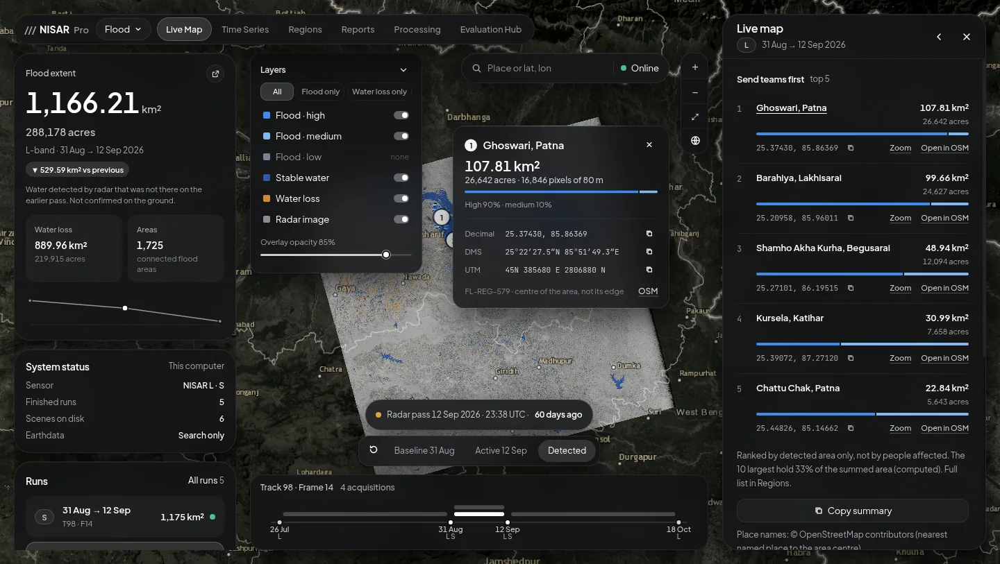

<div align="center">

# NISAR Pro

**Flood maps from NISAR radar. Through cloud, day and night.**

NISAR Pro compares two NISAR radar passes and maps flood extent, stable water and water loss at 80 m,
with every area in km² and acres, place names, field waypoints and a printable situation report.
It runs on an ordinary laptop.

[Website](https://main.nisar-pro.pages.dev/) ·
[Live demo](https://main.nisar-pro.pages.dev/app) ·
[Windows installer](https://github.com/AdityaNarayanNayak-2/NISAR_PRO/releases/latest/download/NISAR-Pro-Setup-1.0.0.exe) ·
[Linux](#linux) ·
[Documentation](Docs/README.md) ·
[Work with us](#work-with-runlayer-lab)

[](LICENSE)




</div>

## Why

During a flood, cloud cover can hide the ground from optical satellites for days. Radar sees through it.
NISAR (NASA–ISRO) images every place every 12 days in L-band, and over India also in S-band, and the data is free.
NISAR Pro turns two of those passes into answers a control room needs:

- **Where is the water?** Flood extent at 80 m, by confidence, plus water that left.
- **How much, and is it growing?** km² and acres, compared with the previous pass.
- **Where do we send teams first?** Largest areas ranked, with village and district names and coordinates.

## Results: Bihar, monsoon 2026

One NISAR scene over the Ganga plain (track 98, frame 14), processed in full on a laptop. Areas are on each
band's own valid grid; the InGARSS package compares L and S on their common grid, so its numbers differ slightly.

| Period | Band | Flood extent | Water loss |
|---|---|---|---|
| 26 Jul → 31 Aug 2026 | L | 1,695.81 km² (419,043 ac) | 1,471.24 km² |
| 31 Aug → 12 Sep 2026 | L | 1,166.21 km² (288,178 ac) | 889.96 km² |
| 31 Aug → 12 Sep 2026 | S | 1,174.89 km² (290,321 ac) | 217.17 km² |

Flood extent is water detected by radar that was not there on the earlier pass. It is not confirmed on the ground.
Water maps were checked against Sentinel-2 optical images on cloud-free pixels; see the
[InGARSS 2026 package](ingarss_2026/README.md) for the method, scores and limits.

## What it does

| | |
|---|---|
| **Engine** | Rust. Streams a full GCOV scene (33,696 × 34,344 px) in 1,024-row strips, averages it to an 80 m grid, and classes the change in backscatter: log-ratio change detection, Otsu reported, region growing, clean-up. A full scene pair (2 × 1.157 billion samples) takes 21–28 s on 4 cores with about 1 GB RAM (measured 2026-11-23; same output byte for byte as the slower first version). |
| **Sentinel-1** | The same engine also reads Sentinel-1 C-band backscatter (RTC GeoTIFFs from Microsoft Planetary Computer, or OPERA RTC-S1), tile by tile: a full scene pair (2 × 609 million samples) on the 80 m grid in about 45 s under 400 MB. More passes between NISAR's 12-day repeats. Find and download scenes with `scripts/fetch_sentinel1.py`. C-band thresholds are the engine's band defaults and have not been checked against Sentinel-2. |
| **Gateway** | Axum. Runs jobs, streams logs live, reuses identical runs, searches and downloads from the NASA ASF catalog, and looks up place names (OpenStreetMap). |
| **Dashboard** | React and MapLibre on a dark satellite basemap. Replay of both passes, numbered areas with coordinates in decimal, DMS and UTM, flood extent per district, change since the last pass, quality checks, and every engine parameter for engineers. |
| **Impact** | Free public data joined to every run: hospitals, schools and police stations within 1 km of the flood extent (OpenStreetMap), river flow on the pass dates and a 30-day river forecast (GloFAS), rain between the passes (ERA5) and the 7-day rain forecast. Each source is named; none of it is NISAR output. |
| **Watch** | Continuous monitoring. Add an area once; every new NISAR pass over it is found in the ASF catalog, downloaded, paired with the pass before and processed with no one pressing a button. Flood extent inside the area goes to a webhook or Telegram when it passes your alert level, and out as an Atom feed of CAP 1.2 alerts (the format disaster agencies use, India's SACHET included). Every run is also in a STAC catalog for QGIS, ArcGIS or any GIS. |
| **Operations** | One container image; one-click VMs on AWS, Azure and Google Cloud plus one installer for any Linux server; optional login, Cloudflare Tunnel, results backup and stop-when-idle; a Redis queue with engine workers that KEDA starts per waiting run (gateway copies share state, a lost worker's run goes back in the queue); a public demo mode where visitors queue runs safely; Terraform for EKS, AKS and GKE with Spot engine nodes from zero, Argo CD; Helm chart, health and readiness probes, Prometheus metrics, alert rules and a Grafana board, CI with tests, template checks, image scan and smoke test. See [deploy/](deploy/README.md). |
| **Outputs** | 2-page situation report (PDF via print), class GeoTIFF (UTM), areas GeoJSON, hotspots CSV, KML and GPX waypoints, report JSON. |

## Install

The app runs a local server and opens the dashboard at `http://localhost:3000`. Your data stays on your machine.
No Rust, Node.js or Python needed.

### Windows

1. Download [NISAR-Pro-Setup-1.0.0.exe](https://github.com/AdityaNarayanNayak-2/NISAR_PRO/releases/latest/download/NISAR-Pro-Setup-1.0.0.exe) and run it (no admin rights needed).
2. Start **NISAR Pro** from the Start Menu.

The installer is not code-signed: on "Windows protected your PC", choose **More info → Run anyway**.
A [portable zip](https://github.com/AdityaNarayanNayak-2/NISAR_PRO/releases/latest/download/NISAR-Pro-1.0.0-windows-x64-portable.zip) is also available.

### Linux

Needs glibc 2.39+ (RHEL 10, Fedora 40+, Ubuntu 24.04+, Debian 13). Installs into your home folder, no `sudo`:

```bash
curl -fsSL https://gitlab.com/api/v4/projects/76194026/packages/generic/nisar-pro/latest/install.sh | bash
nisar-pro
```

Or the [tarball](https://github.com/AdityaNarayanNayak-2/NISAR_PRO/releases/latest/download/NISAR-Pro-1.0.0-linux-x86_64.tar.gz): extract it and run `./nisar-pro`.

### NASA data

Catalog search needs no account. To download, create a free [NASA Earthdata](https://urs.earthdata.nasa.gov/) token
and start the app with `EARTHDATA_TOKEN=<token> nisar-pro` (on Windows, set it as a user environment variable).
A full L-band scene is about 7 GB, S-band about 12.6 GB. 8 GB RAM is enough.

| Problem | Fix |
|---|---|
| Port 3000 in use | Close the other program or old NISAR Pro (`ss -ltnp \| grep :3000`). |
| `GLIBC_2.39 not found` | Older Linux: build from source. |
| Download fails with 401 | Earthdata token missing or expired. |

## Container, cloud and Kubernetes

```bash
curl -fsSL https://raw.githubusercontent.com/AdityaNarayanNayak-2/NISAR_PRO/main/deploy/vm/install.sh | sudo bash   # any Linux VM
podman build -t nisar-pro .                       # or docker build
podman run -p 3000:3000 -v nisar:/var/lib/nisar-pro nisar-pro
podman compose up -d --build                      # with Prometheus and Grafana
helm install nisar deploy/helm/nisar-pro          # Kubernetes, one pod
podman compose -f compose.yaml -f compose.queue.yaml up -d --scale worker=2   # Redis queue + 2 workers
```

Production on Kubernetes: `queue.enabled=true` runs the gateway as several copies and the engine
in worker Jobs that KEDA starts from the Redis queue (0 when idle). Clusters with shared storage
and Spot engine nodes: `deploy/terraform/k8s-eks`, `k8s-aks`, `k8s-gke`; GitOps: `deploy/argocd`.
Public demo: `NISAR_PUBLIC_MODE=on` lets anyone with the link queue a run on the scenes on your
machine (one run per visitor, admin actions behind a login).

One-click VMs: **Deploy to Azure** (`deploy/azure`), **Open in Google Cloud** (`deploy/gcp`), AWS
CloudFormation (`deploy/aws`), Terraform (`deploy/terraform`). Configuration, probes, metrics,
alerts, monitoring areas and a runbook: [deploy/README.md](deploy/README.md).

## Build from source

Requires Git, [Rust](https://rustup.rs/) (stable) and Node.js 20+.

```bash
git clone https://gitlab.com/Aditya-Narayan-Nayak/nisar_pro.git && cd nisar_pro
cargo build --release --manifest-path sar_science_processor/Cargo.toml
cargo build --release --manifest-path sar-gateway/Cargo.toml
(cd sar-dashboard-v3 && npm ci && npm run build)
cd sar-gateway && LOCAL_MODE=true ./target/release/sar-gateway   # http://localhost:3000
```

- Dashboard with live reload: `cd sar-dashboard-v3 && npm run dev` (port 5173, gateway running).
- Engine tests: `cd sar_science_processor && cargo test` (74 pass).
- Engine on its own: `sar_science_processor --help`; the exact Bihar commands are in [ingarss_2026/README.md](ingarss_2026/README.md).

## Repository

```text
sar_science_processor/   Rust engine: streaming HDF5 reader, 80 m multilook, flood detection, GeoTIFF/PNG/GeoJSON
sar-gateway/             Axum server: jobs, live logs, ASF catalog, downloads, geocoding; serves the dashboard
sar-dashboard-v3/        React 19 + MapLibre dashboard, situation report and website
ingarss_2026/            IEEE InGARSS 2026 package: results, validation, technical note, checker script
deploy/                  Helm chart, Prometheus and Grafana config, operations guide
Docs/                    Architecture, design spec, user guides
```

## Scientific boundaries

- Every number is read from the engine's output files; nothing is estimated in the interface.
- Flood extent is radar-detected change. Wet soil, shadow and some crops can look like water.
- Sentinel-2 scores are agreement with optical labels on cloud-free pixels, not accuracy.
- In the Bihar study, fusing L and S improves on L alone but does not beat S alone.

## Work with RunLayer Lab

NISAR Pro is built and run by **RunLayer Lab**. For disaster management authorities and districts we offer:

- **Monsoon pilot**: one district, a map and report after every pass, review at the end.
- **Managed monitoring**: your areas all year, hosted and run by us.
- **On your servers**: installed in your data centre, maintained by us, with staff training.

The first map of a past flood over your area is free. Contact **Aditya Narayan Nayak**, ishaan4488@gmail.com.

## Citation

```bibtex
@software{nisar_pro_2026,
  author    = {Nayak, Aditya Narayan},
  title     = {NISAR Pro: flood mapping from NISAR L- and S-band radar},
  year      = {2026},
  publisher = {RunLayer Lab},
  url       = {https://github.com/AdityaNarayanNayak-2/NISAR_PRO}
}
```

## License

[Apache-2.0](LICENSE). Data: NASA–ISRO NISAR via ASF DAAC. Basemap imagery © Esri. Place names and facilities © OpenStreetMap contributors (ODbL). River flow: GloFAS (Copernicus); rain: ERA5 and forecasts via Open-Meteo (CC BY 4.0).
