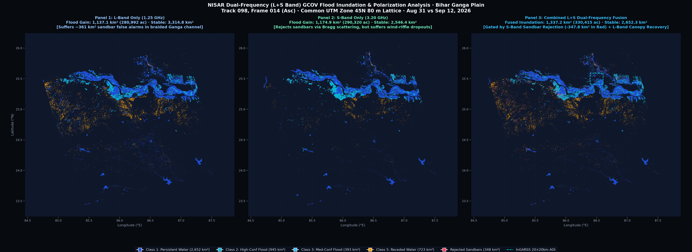

# NISAR Pro

NISAR Pro is an open-source, local-first platform for processing and explaining
NISAR Earth-observation data. It combines a memory-efficient Rust science
engine, a local Axum gateway, and a geospatial React dashboard so researchers
can move from a large satellite product to inspectable maps, reports, and
reproducible analysis.

It is not only a Bihar flood demo. Bihar is one documented case study used to
demonstrate the platform's L-band, S-band, temporal-change, and fusion
capabilities.

<div align="center">

[](LICENSE)
[](https://www.rust-lang.org/)
[](https://nisar.jpl.nasa.gov/)
[](sar-dashboard-v3/)

[Live dashboard](https://adityanarayannayak-2.github.io/NISAR_PRO/) ·
[Architecture](Docs/Architecture/) ·
[User guides](Docs/UserGuide/) ·
[InGARSS case study](ingarss_2026/)

</div>

---

## What NISAR Pro is for

NISAR Pro is built for engineers, remote-sensing researchers, and teams who
need to process large NISAR products on infrastructure they control.

The platform focuses on four things:

- **Efficient ingestion** of large HDF5-based NISAR products without loading an
  entire scene into memory.
- **Explainable SAR processing** with visible parameters, intermediate
  telemetry, and geospatial outputs instead of opaque black-box results.
- **Local execution and data sovereignty** so raw granules can remain on the
  operator's workstation or internal server.
- **A reusable platform** for GCOV surface-water analysis, L/S comparison,
  temporal change detection, and InSAR/infrastructure workflows.


## Platform capabilities

### NISAR product access and ingestion

- NASA ASF / Earthdata catalogue integration for supported NISAR products.
- Local HDF5 product selection for offline or controlled environments.
- Instrument and band identification from product metadata.
- Coordinate, footprint, acquisition-date, CRS, and channel inspection.
- Windowed and row-strip reading for products that are too large for naive
  in-memory workflows.

### Rust science engine

The `sar_science_processor` crate contains the computational core. Current
processing modules include:

- GCOV backscatter and covariance-channel handling.
- L-band and S-band product support where the selected product metadata
  provides the required channels.
- Block multilooking and calibrated linear-power to dB conversion.
- Speckle filtering, nodata protection, swath-edge conditioning, and memory
  guards.
- Log-ratio change detection, adaptive thresholding, seeded region growing,
  morphology, and connected-component filtering.
- InSAR building blocks including coregistration, coherence, phase filtering,
  unwrapping, deramping, and deformation-oriented outputs.
- GeoTIFF, PNG, GeoJSON, and JSON report generation.

### Local gateway

The Axum gateway is the operational boundary around the processor. It provides:

- Local job creation and supervision.
- Server-Sent Events for live processing progress.
- Local result history and artifact discovery.
- NASA catalogue/search proxy functions.
- Safe subprocess execution of the science processor.
- Static serving of the built dashboard on port `3000`.

### Geospatial dashboard

The React/Leaflet dashboard provides a visual workspace for:

- Map-first product inspection.
- Flood and surface-water analysis.
- Infrastructure and deformation-oriented workflows.
- L-band, S-band, and paired-analysis configuration.
- Raster, vector, report, and replay views.
- Downloadable outputs and visible processing telemetry.

The dashboard can be hosted as a static site while connecting to a gateway
running on the user's own machine.

## Why the engine is different

Large SAR products expose a practical systems problem: a single scene can be
several gigabytes, while a workstation may have only 8--16 GB of RAM. NISAR
Pro avoids the naive pattern of loading the complete scene before processing.

Instead, it reads bounded HDF5 regions, processes strips, and reduces the data
to the working lattice needed by the selected analysis. This makes the memory
cost depend primarily on the working window and processing buffers rather than
the full raw scene size.

The benchmark evidence currently recorded in this repository includes:

| Workload | Recorded result |
| --- | --- |
| Full-scene two-date Bihar L-band processing | approximately 43 seconds on the documented RHEL workstation |
| Full-scene working memory | below approximately 1.79 GB for the documented run |
| Tactical synthetic/unit benchmark | separate low-memory benchmark; do not confuse it with full-scene RSS |
| Science processor unit tests | deterministic tests covering parser, multilook, flood, InSAR, IO, and memory guards |

These numbers are machine- and configuration-dependent. They are reported with
the associated provenance rather than presented as a universal guarantee.

## Architecture

```text
NISAR sources / local HDF5 files
              |
              v
Product discovery, metadata, coordinates, channel inventory
              |
              v
Rust science engines
  - GCOV surface water and change
  - L/S comparison and fusion
  - InSAR and deformation workflows
              |
              v
Axum local gateway and result store
              |
       +------+------+
       |             |
       v             v
React dashboard   CLI / notebook / reports
```


The architecture diagram intentionally separates the reusable platform layers
from individual domain case studies.

## Flagship case study: Bihar L/S surface-water change

The InGARSS 2026 Bihar work demonstrates one complete path through the
platform using NISAR L2 GCOV products over the Ganga alluvial plain.

It compares:

1. L-band-only surface-water/change mapping.
2. S-band-only surface-water/change mapping.
3. A documented L+S comparison on common spatial support.
4. Multi-date water gain, stable water, water loss, and stable non-water.
5. Channel and polarization information where the selected granules support it.



The case study is deliberately documented with acquisition IDs, processing
parameters, coverage limitations, product metadata, and provenance. It should
be read as a scientific demonstration of the platform, not as a claim that
every detected change is automatically a flood or that fusion is always better.

## Output model

Each completed local job can produce a structured result directory containing:

```text
results/jobs/<job-id>/
  <job-id>_flood.json          # metrics, parameters, product metadata
  <job-id>_flood.geo.json      # vectorized regions
  <job-id>_flood_class.tif     # georeferenced classification raster
  <job-id>_flood.png           # rendered classification map
  <job-id>_flood_active.png    # active observation render
  <job-id>_flood_baseline.png  # baseline observation render
  crash_journal.log            # failure and memory-guard context
```

The JSON report is the machine-readable source for dashboard metrics. The
GeoTIFF and GeoJSON are intended for GIS and scientific review. PNG files are
convenient for reports and presentations.

## Running locally from source

### Full local stack

Requirements: Rust toolchain, Node.js 20+, and a supported operating system.

```bash
# Build the science engine
cd sar_science_processor
cargo build --release

# Start the local gateway
cd ../sar-gateway
LOCAL_MODE=true RUST_LOG=info cargo run

# In another terminal, start the dashboard during development
cd ../sar-dashboard-v3
npm ci
npm run dev
```

For a built dashboard served by the gateway, build the frontend first and use
the packaged/local launcher described below.

### Windows and Linux release packages

The release pipeline produces platform packages that do not require users to
install Rust, Cargo, Node.js, or Python.

Windows:

```text
Extract NISAR-Pro-1.0.0-windows-x64.zip
Double-click NISAR-Pro-1.0.0.exe
```

Linux x86_64:

```bash
tar -xzf NISAR-Pro-1.0.0-linux-x86_64.tar.gz
cd NISAR-Pro-1.0.0-linux-x86_64
./nisar-pro
```

The packaged application starts the gateway, opens `http://localhost:3000`,
and keeps raw NISAR files on the local machine. Original `.h5` granules are
not included in releases.

## Repository layout

```text
sar_science_processor/   Rust science engine
sar-gateway/             Axum gateway, job orchestration, catalogue clients
sar-dashboard-v3/        React, Vite, Leaflet dashboard
installer/               Windows launcher and Linux launcher/installer
Docs/                    Architecture, user, API, and operational guides
scripts/                 Scientific utilities and verification helpers
results/                 Local/generated result workspace
ingarss_2026/            InGARSS case-study package and evidence
```

## Reproducibility and scientific boundaries

NISAR Pro records the selected product IDs, dates, channels, CRS, resolution,
thresholds, and output paths in reports where available. The processing
documentation distinguishes:

- measured outputs from interpretation;
- common-support comparisons from standalone runs;
- full-scene results from reference-box inspection;
- quantitative validation from qualitative assessment.

When independent reference labels are unavailable, the project does not invent
accuracy scores. The likely effects of temporal mismatch, viewing geometry,
vegetation, rough soil, wind-roughened water, mixed pixels, and nodata are
reported as uncertainty instead.

## Documentation

- [Architecture documentation](Docs/Architecture/)
- [Flood detection pipeline](Docs/Architecture/flood_detection_pipeline.md)
- [Gateway orchestration](Docs/Architecture/gateway_orchestration.md)
- [Frontend architecture](Docs/Architecture/frontend-dashboard-architecture.md)
- [Windows local run guide](Docs/UserGuide/windows-local-run.md)
- [Release packaging guide](Docs/UserGuide/release-packaging.md)
- [API reference](Docs/UserGuide/api-reference.md)
- [InGARSS 2026 submission package](ingarss_2026/)

## Roadmap

- Broader NISAR product coverage and validated metadata adapters.
- More complete polarimetric feature inventories by acquisition mode.
- Quantitative reference-label validation workflows.
- Native Linux package formats (`.deb` and `.rpm`) after the portable package
  is stable.
- Additional local and hosted collaboration workflows without moving raw
  granules off the operator's machine.

## Citation

```bibtex
@software{nisar_pro_2026,
  author = {Nayak, Aditya Narayan},
  title = {NISAR Pro: Open-source local-first processing and analysis for NISAR Earth-observation products},
  year = {2026},
  publisher = {GitHub},
  url = {https://github.com/AdityaNarayanNayak-2/NISAR_PRO}
}
```

## License

Distributed under the Apache-2.0 or MIT License. See [LICENSE](LICENSE).
