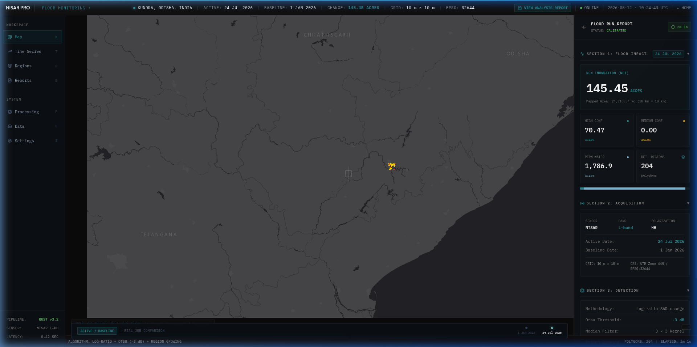
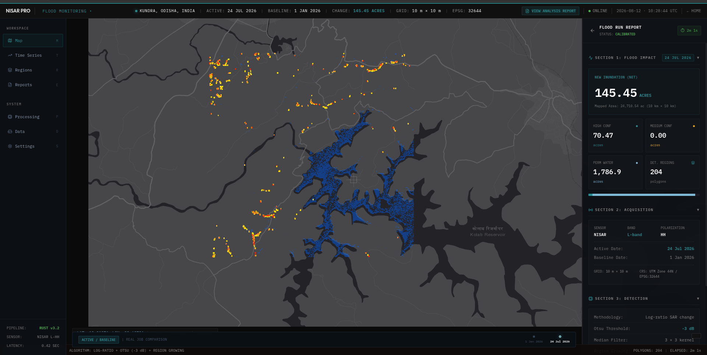
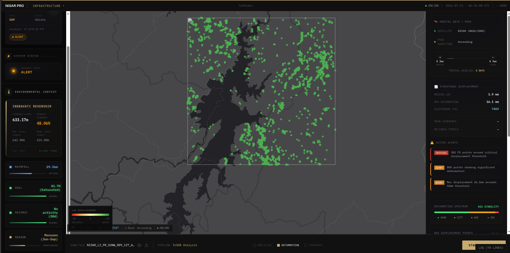
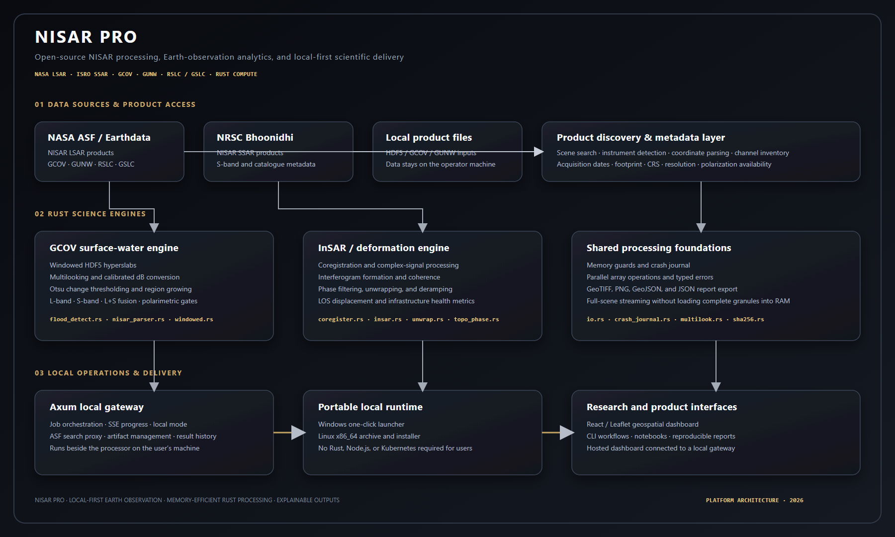

# NISAR Pro

**Flood maps, dam deformation, and SAR science — computed locally from NASA–ISRO NISAR data.**

NISAR Pro is a local-first SAR analysis workspace. You pick a flood event or a dam, the dashboard finds the relevant NISAR L2 granules, and the Rust compute engine on your own machine turns them into change maps, inundation polygons, and millimeter-level displacement plots. Your data never leaves your hardware.

## What it looks like

**[Live demo → https://nisar-pro.pages.dev](https://nisar-pro.pages.dev)**

A real flood run on the Upper Kolab Reservoir — 145.45 acres of new inundation detected from a 12-day GCOV pair:



The full workspace — search AOI, acquisition slots, and the pipeline monitor:



Infrastructure monitoring profile (dam deformation / persistent scatterers):



System architecture at a glance:



## What it does

- **Flood detection** — multi-temporal change detection on GCOV pairs: radiometric calibration, speckle suppression, log-ratio change, adaptive thresholding, two-threshold region growing, and confidence scoring (7-stage pipeline in `flood_detect.rs`).
- **Dam & infrastructure monitoring** — InSAR (GUNW) processing and persistent-scatterer classification to track deformation down to millimeter scale.
- **SAR science** — covariance processing, amplitude mapping and polarization analysis from GCOV / GSLC / RSLC products.
- **ASF catalog integration** — search and stream-download NISAR granules with progress, straight from the dashboard (NASA CATALOG mode).

The dashboard talks to a local gateway over HTTP/SSE; the gateway shells out to the Rust CLI worker. Both run on your machine.

## Quick start

### Windows (recommended)

Run three terminals:

```powershell
# Terminal 1 — build the compute engine once
cd sar_science_processor
cargo build

# Terminal 2 — start the local gateway
cd sar-gateway
$env:LOCAL_MODE = "true"
$env:RUST_LOG = "info"
cargo run

# Terminal 3 — start the dashboard
cd sar-dashboard-v3
npm install
npm run dev
```

Open <http://127.0.0.1:5173/>. Keep Terminals 2 and 3 open while using the app.

### Linux / macOS

```bash
# 1. compute engine
cd sar_science_processor && cargo build

# 2. gateway
cd ../sar-gateway
LOCAL_MODE=true RUST_LOG=info cargo run

# 3. dashboard
cd ../sar-dashboard-v3
npm install
npm run dev
```

### Earthdata credentials

Catalog search and download need NASA Earthdata credentials. Set them in `sar-gateway/.env` (this file is git-ignored, never commit it):

```
EARTHDATA_USERNAME=you@example.com
EARTHDATA_PASSWORD=...

# or a single bearer token:
EARTHDATA_TOKEN=...
```

If you're set up for ESA S-band data, add `ESA_USERNAME` / `ESA_PASSWORD` likewise.

## Repository layout

```
nisar_pro/
├── sar-dashboard-v3/       React + Leaflet + Vite dashboard (workspace, landing, /docs)
├── sar-gateway/            Async Axum gateway — REST + SSE, job supervisor, ASF/ESA clients
├── sar_science_processor/  Pure-Rust science engine (flood detection, InSAR)
├── sar_processor/          Processor build tree (CLI workers)
├── sar_operator_v2/        Kubernetes operator (job CRDs)
├── Docs/                   The documentation hub
└── .github/                Workflow automation
```

## Documentation

The docs live in [`Docs/`](Docs/README.md) and are also rendered inside the dashboard at the `/docs` route.

- **User guides** — [Getting Started](Docs/UserGuide/getting-started.md), [Windows local run](Docs/UserGuide/windows-local-run.md), the [friendly manual](Docs/UserGuide/userguide.md), [API reference](Docs/UserGuide/api-reference.md), and an [InSAR verification log](Docs/UserGuide/insar-verification-log.md).
- **Architecture** — the [7-stage flood pipeline](Docs/Architecture/flood_detection_pipeline.md), [processor internals](Docs/Architecture/sar_processor_internals.md), [gateway orchestration](Docs/Architecture/gateway_orchestration.md), and a [design index](Docs/Architecture/architecture-diagrams.md).

## Tech stack

Rust (HDF5/ndarray) · Axum + tokio · React + Leaflet + Vite · TiTiler COGs · SSE streaming

## License

See [LICENSE](LICENSE).