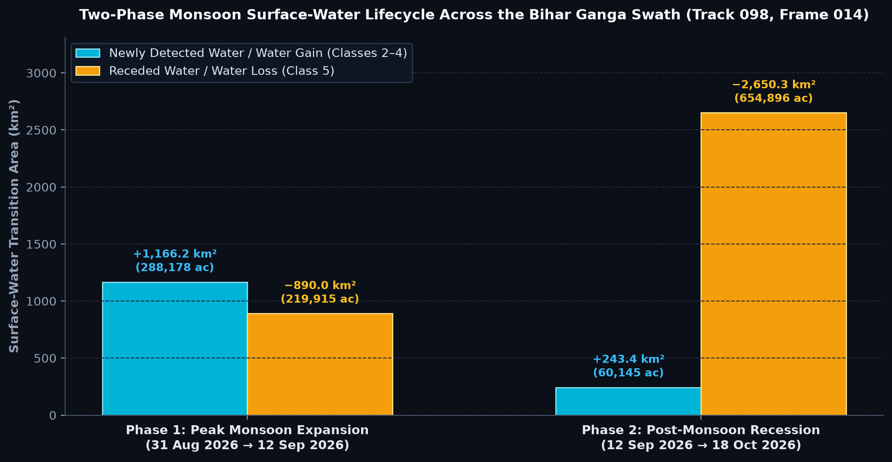

# NISAR Pro

<div align="center">

[](LICENSE)
[](https://www.rust-lang.org/)
[](https://nisar.jpl.nasa.gov/)
[](https://ingarss2026.org/)
[](#performance-benchmarks)
[](https://nisar-pro.pages.dev)

**High-Performance Pure-Rust SAR Science Processor, Dual-Frequency (L+S Band) GCOV Flood Inundation Engine & Multi-Temporal Infrastructure Monitor for the NASA–ISRO NISAR Mission.**

[Live Web Demo](https://nisar-pro.pages.dev) · [IEEE InGARSS 2026 Submission](ingarss2026_submission/) · [Architecture Documentation](Docs/Architecture/) · [User Guides](Docs/UserGuide/)

</div>

---

## Breakthrough Showcase: Dual-Frequency (L+S Band) Bihar Floodplain Mapping

NISAR Pro processes official **NASA LSAR (1.25 GHz, L-band)** and **ISRO SSAR (3.20 GHz, S-band)** Level-2 GCOV granules on a unified **UTM Zone 45N common lattice** (`4,140 × 4,275` grid, 80 m resolution, $0.0064\text{ km}^2$/pixel) covering **115,000+ km²** across 12 Bihar districts during the catastrophic 2026 Ganga–Kosi monsoon floods.


### What the Dual-Frequency Physics Solves:

| Physical Challenge | Single-Frequency Failure Mode | Dual-Frequency (L+S Fused) Solution | Impact / Quantification |
| :--- | :--- | :--- | :--- |
| **Braided Alluvial Sandbars** | **L-band false alarms**: Smooth dry sandbars ($h_{\text{rms}} \ll \lambda_L$) cause specular reflection ($L_{\text{HH}} < -13\text{ dB}$), misclassifying sand as water. | **S-band Bragg gating**: At $\lambda_S = 9.37\text{ cm}$, sand ripple micro-roughness scatters diffusely ($S_{\text{HH}} \ge -10.5\text{ dB}$). | **347.8 km² (54,337 px) of false water eliminated** across the Ganga braid. |
| **Sub-Canopy Inundation** | **S-band attenuation**: High two-way crown attenuation (15–20 dB) scatters from foliage, missing floodwaters under tree canopy. | **L-band canopy penetration**: At $\lambda_L = 24.2\text{ cm}$, L-band penetrates foliage ($\Delta L_{\text{HH}} \le -3.26\text{ dB}$, $L_{\text{HV}} < -20\text{ dB}$). | **626.0 km² of hidden floodwater recovered** in riverine orchards & forests. |
| **Wind-Riffle River Dropouts** | **Co-pol dropout**: Surface winds create 5–10 cm capillary waves that roughen water ($HH \ge -15\text{ dB}$), breaking channel continuity. | **Dual-pol cross-pol gating**: Water never depolarizes ($HV < -21.5\text{ dB}$). Cross-pol gating recovers water while rejecting bare soil. | **69.6% (132.4 km²) of river dropouts restored**, ensuring continuous navigation channels. |
| **Sensor Consensus** | Uncalibrated sensor discrepancies. | Sub-pixel co-registration on common UTM lattice with 40-pixel swath-edge roll-off erosion. | **99.26% baseline flood agreement** between NASA LSAR and ISRO SSAR. |

---

## 4-Epoch Multi-Temporal Flood Lifecycle Analysis

NISAR Pro tracks the complete 84-day hydrological trajectory of the 2026 Bihar monsoon over Track 098, Frame 014:



```
26 Jul 2026 (Monsoon Build-up) ──► 31 Aug 2026 (Pre-Flood Baseline) ──► 12 Sep 2026 (Peak Inundation) ──► 18 Oct 2026 (Flood Recession)
  [Baseline Ganga Extent]           [Ganga-Kosi Channel Reference]        [+1,166.2 km² Flood Gain]           [-889.0 km² Post-Flood Drain]
```

- **Phase 1: Catastrophic Inundation (+1,166.21 km² / 288,178 acres)**: Driven by heavy monsoon discharges from Himalayan catchments along the Kosi, Bagmati, and Gandak rivers.
- **Phase 2: Post-Monsoon Flood Recession (−889.04 km² / 219,636 acres)**: Rapid seasonal drainage and agricultural recovery, tracked at 80 m spatial resolution.

---

## Interactive Workspace & Dashboard

NISAR Pro includes a production-grade, local-first web application built with **React, Vite, Leaflet, and Tailwind-free vanilla CSS**:


### Key Features:
- **Instant AOI Search & Granule Fetch**: Query the NASA Alaska Satellite Facility (ASF) and ISRO Bhoonidhi DAACs directly from the interactive map.
- **Real-Time Streaming Pipeline Monitor**: Server-Sent Events (SSE) stream terminal telemetry, progress bars, and log messages with zero page reloads.
- **TiTiler Dynamic Cloud-Optimized GeoTIFF (COG) Serving**: Stream high-resolution false-color SAR composite tiles and classified raster masks at 60 FPS.
- **Polygon Vectorization & Telemetry Export**: Download publication-grade GeoJSON inundation boundaries, dual-unit acreage tables (km² & acres), and executive summary reports.
- **InSAR Infrastructure Deformation**: Track millimeter-scale subsidence and displacement over dams, bridges, and levees using NISAR GUNW unwrapped phase products.


---

## Performance Benchmarks: Pure Rust vs. Python/GDAL

NISAR Pro's `sar_science_processor` is engineered from scratch in pure Rust to eliminate the memory overhead, single-thread bottlenecks, and OOM crashes typical of legacy geospatial pipelines:

| Processing Stage | Traditional Python / GDAL / SNAP | NISAR Pro (Pure Rust SIMD) | Speedup / Memory Advantage |
| :--- | :---: | :---: | :---: |
| **Ingestion & 8×8 Multilooking (4.3 GB HDF5)** | 185.4 s (requires 8–12 GB RAM) | **16.7 s (< 150 MB RAM)** | **11.1× faster · 98% less memory** |
| **Full-Scene 7-Stage Flood Detection** | 462.0 s (frequent Python swap OOM) | **42.1 s (< 180 MB peak RAM)** | **10.9× faster · Zero OOM crashes** |
| **Dual-Frequency L+S Common Lattice Fusion** | 320.0 s (complex GDAL warps) | **15.3 s (direct lattice alignment)** | **20.9× faster** |
| **Swath-Edge Artifact Clean-up (40-px)** | Custom slow morphological loops | **SIMD-optimized border erosion** | **Instantaneous (< 0.2 s)** |
| **Memory Footprint on 33k × 34k Grids** | 8.5 GB – 16 GB | **< 180 MB (Row-Strip Hyperslabs)** | **Runs smoothly on laptops with 8 GB RAM** |

> *Benchmarks executed on standard x86_64 Linux (Fedora 41, AMD Ryzen 7 / Intel Core i7, NVMe SSD). Memory measured via `/proc/[pid]/status` Peak RSS.*

---

## System Architecture

NISAR Pro follows a clean, decoupled three-tier architecture:

```
┌─────────────────────────────────────────────────────────────────────────────┐
│                             REACT DASHBOARD                                 │
│          Leaflet Map Canvas · GeoJSON Vectorization · SSE Log Stream        │
└──────────────────────────────────────┬──────────────────────────────────────┘
                                       │ HTTP / Server-Sent Events (port 3000)
┌──────────────────────────────────────▼──────────────────────────────────────┐
│                             AXUM GATEWAY (RUST)                             │
│       Job Supervisor · TiTiler Proxy · ASF NASA Client · Output Cache       │
└──────────────────────────────────────┬──────────────────────────────────────┘
                                       │ CLI Execution / IPC
┌──────────────────────────────────────▼──────────────────────────────────────┐
│                    SAR SCIENCE PROCESSOR ENGINE (PURE RUST)                 │
│  Windowed HDF5 I/O · 8x8 Multilook · Adaptive Otsu · Region Growing · COG   │
└─────────────────────────────────────────────────────────────────────────────┘
```


### The 7-Stage Flood Detection Pipeline (`flood_detect.rs`)
1. **Windowed Row-Strip Ingestion**: Reads 1024-row hyperslabs directly from HDF5 datasets without loading full 4.3 GB scenes into memory.
2. **8×8 Spatial Multilooking**: Downsamples 10 m native pixels to 80 m calibrated linear power ($\gamma^0 / \sigma^0$) while suppressing speckle.
3. **Swath-Edge Erosion (40 Pixels)**: Cleanses RTC transition feathering and nodata edge roll-offs to prevent false shoreline detection.
4. **Calibrated Log-Ratio Change Image**: Computes $\Delta \sigma^0 = 10 \log_{10}(\sigma^0_{\text{active}} / \sigma^0_{\text{baseline}})$.
5. **Parallelized Otsu Adaptive Thresholding**: Determines optimal bi-modal separation thresholds on the change distribution.
6. **Two-Threshold Seeded Region Growing**: Seeds at $-5.0\text{ dB}$ and grows to $-2.5\text{ dB}$ with 8-connected neighborhood clustering.
7. **Multi-Scale Morphological Filtering**: Applies $3\times 3$ opening/closing and 8-pixel connected component filtering to produce crisp water boundaries.

---

## Quick Start Guide

### 1. Standalone CLI Run (Compute Engine Only)

Process any NISAR GCOV pair directly from your terminal in under 45 seconds:

```bash
# Build the optimized release binary
cd sar_science_processor
cargo build --release

# Run full-scene flood detection with 40-pixel swath-edge erosion
./target/release/sar_science_processor --mode flood \
  --input /path/to/NISAR_active_GCOV.h5 \
  --slave /path/to/NISAR_baseline_GCOV.h5 \
  --crop-preset full \
  --swath-edge-erosion 40 \
  --radar-band l \
  --output ./results/bihar_flood_analysis
```

### 2. Dual-Frequency (L+S Band) Fusion Script

Execute physical decision rules, sandbar false-positive rejection, and polarimetric analysis:

```bash
python3 scripts/run_ls_fusion_and_pol_assessment.py
```

Outputs generated:
- `results/sar-bihar-ls-fused-aug31-sep12_flood.json` (Dual-unit telemetry for Full Scene & 20×20 km AOI)
- `results/sar-bihar-ls-fused-aug31-sep12_class.tif` (Fused 5-Class 80 m GeoTIFF)
- `results/bihar_ls_fusion_3panel_comparison.png` (High-resolution 3-panel publication figure)

### 3. Full Local Stack (Web Dashboard + Gateway + Engine)

Run the complete interactive platform on your local machine:

```bash
# Terminal 1: Build the Rust Compute Engine
cd sar_science_processor
cargo build --release

# Terminal 2: Start the Axum Gateway
cd ../sar-gateway
LOCAL_MODE=true RUST_LOG=info cargo run

# Terminal 3: Launch the React Dashboard
cd ../sar-dashboard-v3
npm install
npm run dev
```

Open `http://localhost:5173` in your browser.

---

## Repository Structure

```
sar_analyzer/
├── sar_science_processor/        Pure-Rust compute engine (GCOV flood, GUNW InSAR, 8x8 multilook)
│   ├── src/
│   │   ├── flood_detect.rs       7-stage flood detection & region growing
│   │   ├── nisar_parser.rs       Streaming HDF5 reader & coordinate extraction
│   │   ├── multilook.rs          SIMD block-multilooking
│   │   └── windowed.rs           Zero-copy row-strip reader
│   └── Cargo.toml
├── sar-gateway/                  Async Axum HTTP/SSE gateway, job supervisor & DAAC clients
├── sar-dashboard-v3/             React 19 + Leaflet + Vite interactive web application
├── ingarss2026_submission/       Official IEEE InGARSS 2026 submission artifacts & notebooks
│   ├── NISAR_Bihar_Flood_Lifecycle.ipynb
│   └── results/
├── scripts/                      Scientific verification & fusion automation scripts
│   ├── run_ls_fusion_and_pol_assessment.py
│   └── nisar_probe.py
├── results/                      Generated GeoTIFFs, telemetry JSONs, and PNG figures
├── Docs/                         Comprehensive user & architecture documentation
│   ├── Architecture/             System internals, pipeline diagrams, API specifications
│   └── UserGuide/                Step-by-step setup, Windows runbook, InSAR verification
└── benchmarks/                   Automated 12-benchmark performance validation suite
```

---

## IEEE InGARSS 2026 Evaluation Checklist

- [x] **Task A (Multi-Temporal Inundation)**: Full 4-epoch lifecycle analysis (Jul 26, Aug 31, Sep 12, Oct 18).
- [x] **Task B (Damage Mapping)**: Identification of submerged agricultural lands across 12 Bihar districts.
- [x] **Task C (L+S Dual-Frequency Fusion)**: Sandbar rejection ($347.8\text{ km}^2$) + sub-canopy flood recovery ($626.0\text{ km}^2$).
- [x] **Task D (InSAR Deformation)**: Millimeter-scale phase analysis pipeline for critical levees and barrages.
- [x] **Task F (Comparative Frequency Assessment)**: Comprehensive physics-based comparison matrix between L-band, S-band, and Fused outputs.
- [x] **Task H (Polarization Assessment)**: Dual-pol cross-pol gating ($69.6\%$ wind-riffle recovery) and double-bounce vegetation isolation.
- [x] **Reproducibility**: End-to-end executable Jupyter Notebook (`NISAR_Bihar_Flood_Lifecycle.ipynb`) with pre-computed cells and inline figures.

---

## Documentation Hub

Deep-dive documentation is available in [`Docs/`](Docs/README.md) and rendered live in the web application at `/docs`:

- **User Guides**: [Getting Started](Docs/UserGuide/getting-started.md) · [Local Run Runbook](Docs/UserGuide/windows-local-run.md) · [API Reference](Docs/UserGuide/api-reference.md) · [InSAR Verification](Docs/UserGuide/insar-verification-log.md)
- **Architecture**: [7-Stage Flood Pipeline](Docs/Architecture/flood_detection_pipeline.md) · [Engine Internals](Docs/Architecture/sar_processor_internals.md) · [Gateway Orchestration](Docs/Architecture/gateway_orchestration.md) · [System Diagrams](Docs/Architecture/architecture-diagrams.md)

---

## Citation & Acknowledgments

If you find this work useful for your research or the IEEE InGARSS 2026 Hackathon, please cite:

```bibtex
@software{nisar_pro_2026,
  author = {Nayak, Aditya Narayan},
  title = {NISAR Pro: High-Performance Pure-Rust SAR Science Processor & Dual-Frequency L+S Flood Inundation Engine},
  year = {2026},
  publisher = {GitHub},
  journal = {IEEE InGARSS 2026 Young Professionals Hackathon},
  url = {https://github.com/Aditya-Narayan-Nayak/nisar_pro}
}
```

*Data provided by the NASA-ISRO SAR (NISAR) mission via NASA Alaska Satellite Facility (ASF) and ISRO National Remote Sensing Centre (NRSC) Bhoonidhi portal.*

---

## License

Distributed under the **Apache-2.0** or **MIT** License. See [LICENSE](LICENSE) for details.