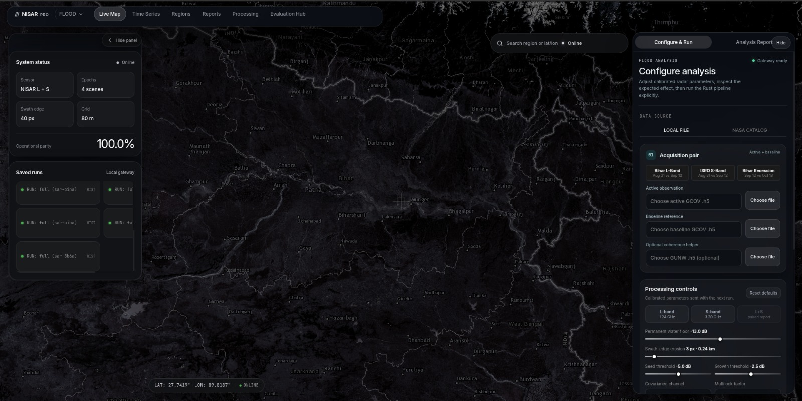
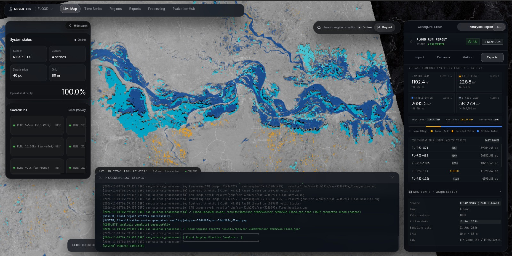

# NISAR Pro

NISAR Pro is an open-source, local-first platform for processing and explaining
NISAR Earth-observation data. It combines a memory-efficient Rust science
engine, a local Axum gateway, and a geospatial React dashboard so researchers
can move from a large satellite product to inspectable maps, reports, and
reproducible analysis.

It is not only a Bihar flood demo. Bihar is one documented case study used to
demonstrate the platform's L-band, S-band, temporal-change, and fusion
capabilities.

<div align="center">

[](LICENSE)
[](https://www.rust-lang.org/)
[](https://nisar.jpl.nasa.gov/)
[](https://ingarss2026.org/)
[](https://main.nisar-pro.pages.dev/)

[Live Dashboard](https://main.nisar-pro.pages.dev/) ·
[Architecture](Docs/Architecture/) ·
[User Guides](Docs/UserGuide/) ·
[IEEE InGARSS 2026 Package](ingarss_2026/)

</div>

---

## What NISAR Pro is for

NISAR Pro is built for engineers, remote-sensing researchers, and teams who
need to process large NISAR products on infrastructure they control.

The platform focuses on four things:

- **Efficient ingestion** of large HDF5-based NISAR products without loading an
  entire scene into memory.
- **Explainable SAR processing** with visible parameters, intermediate
  telemetry, and geospatial outputs instead of opaque black-box results.
- **Local execution and data sovereignty** so raw granules can remain on the
  operator's workstation or internal server.
- **A reusable platform** for GCOV surface-water analysis, L/S comparison,
  temporal change detection, and InSAR/infrastructure workflows.



## Platform capabilities

### NISAR product access and ingestion

- NASA ASF / Earthdata catalogue integration for supported NISAR products.
- Local HDF5 product selection for offline or controlled environments.
- Instrument and band identification from product metadata.
- Coordinate, footprint, acquisition-date, CRS, and channel inspection.
- Windowed and row-strip reading for products that are too large for naive
  in-memory workflows.

### Rust science engine

The `sar_science_processor` crate contains the computational core. Current
processing modules include:

- GCOV backscatter and covariance-channel handling.
- L-band and S-band product support where the selected product metadata
  provides the required channels.
- Block multilooking and calibrated linear-power to dB conversion.
- Speckle filtering, nodata protection, swath-edge conditioning, and memory
  guards.
- Log-ratio change detection, adaptive thresholding, seeded region growing,
  morphology, and connected-component filtering.
- InSAR building blocks including coregistration, coherence, phase filtering,
  unwrapping, deramping, and deformation-oriented outputs.
- GeoTIFF, PNG, GeoJSON, and JSON report generation.

### Local gateway

The Axum gateway is the operational boundary around the processor. It provides:

- Local job creation and supervision.
- Server-Sent Events for live processing progress.
- Local result history and artifact discovery.
- NASA catalogue/search proxy functions.
- Safe subprocess execution of the science processor.
- Static serving of the built dashboard on port `3000`.

### Geospatial dashboard

The React/Leaflet dashboard provides a visual workspace for:

- Side-by-side or layered inspection of flood rasters and vector masks.
- Scene footprints, baseline vs. event comparison, and timeline scrubbers.
- Inundation summaries, persistence metrics, and area accounting.
- Interactive threshold adjustments with immediate preview where supported.
- InSAR deformation inspection with point-level coherence and displacement.
- JSON report inspection and artifact downloads.

### InGARSS 2026 case study: Bihar flood lifecycle

The repository preserves the documented 2026 Bihar monsoon flood case study
developed for the IEEE InGARSS 2026 Young Professionals Hackathon:

- Full-scene dual-epoch L-band flood mapping (2026-08-31 to 2026-09-12).
- S-band comparison for the same acquisition window.
- Common-support L+S comparison and cross-frequency agreement.
- Post-monsoon recession observation through 2026-10-18.
- Independent validation workflow against public high-resolution references.
- Offline and reproducible deliverables in `ingarss_2026/`.



## Architecture overview

```text
               ┌──────────────────────────────────────────────────┐
               │              Web Browser / Dashboard             │
               │         React 19 · Leaflet · Vite · UI           │
               └─────────────────────────┬────────────────────────┘
                                         │ HTTP / SSE (Port 3000)
                                         ▼
               ┌──────────────────────────────────────────────────┐
               │                 Local SAR Gateway                │
               │          Rust Axum · Supervisor · Proxies        │
               └──────────────┬───────────────────┬───────────────┘
                              │                   │
               Spawns CLI jobs│                   │ Proxies search
                              ▼                   ▼
    ┌───────────────────────────────┐   ┌──────────────────────────┐
    │     sar_science_processor     │   │ NASA ASF / CMR Search    │
    │  Pure Rust · SIMD · HDF5/GCOV │   │ Remote granule discovery │
    └──────────────┬────────────────┘   └──────────────────────────┘
                   │
                   ▼
    ┌───────────────────────────────┐
    │       Output Artifacts        │
    │ GeoTIFF · GeoJSON · JSON · PNG│
    └───────────────────────────────┘
```

See [Docs/Architecture/](Docs/Architecture/) for deep-dive pipeline descriptions,
data flows, and telemetry formats.

## Demonstration media

The project includes illustrative visual and video assets:

- [Platform dashboard overview](Docs/assets/Dashboard.jpeg)
- [System architecture diagram](Docs/assets/architecture_overview.svg)
- [Demonstration walkthrough video](Docs/assets/nisar-s-band-demo.mp4)
- [Example analysis output](Docs/assets/output.jpeg)

These assets demonstrate the workflow without requiring large data downloads
convenient for reports and presentations.

## Running locally from source

### Full local stack

Requirements: Rust toolchain, Node.js 20+, and a supported operating system.

```bash
# Build the science engine
cd sar_science_processor
cargo build --release

# Start the local gateway
cd ../sar-gateway
LOCAL_MODE=true RUST_LOG=info cargo run

# In another terminal, start the dashboard during development
cd ../sar-dashboard-v3
npm ci
npm run dev
```

For a built dashboard served by the gateway, build the frontend first and use
the packaged/local launcher described below.

### Windows and Linux release packages

The release pipeline produces platform packages that do not require users to
install Rust, Cargo, Node.js, or Python.

Windows:

```text
Extract NISAR-Pro-1.0.0-windows-x64.zip
Double-click NISAR-Pro-1.0.0.exe
```

Linux x86_64:

```bash
tar -xzf NISAR-Pro-1.0.0-linux-x86_64.tar.gz
cd NISAR-Pro-1.0.0-linux-x86_64
./nisar-pro
```

The packaged application starts the gateway, opens `http://localhost:3000`,
and keeps raw NISAR files on the local machine. Original `.h5` granules are
not included in releases.

## Repository layout

```text
sar_analyzer/
├── sar_science_processor/        Pure-Rust compute engine (GCOV flood, GUNW InSAR, 8x8 multilook)
│   ├── src/
│   │   ├── flood_detect.rs       7-stage flood detection & region growing
│   │   ├── nisar_parser.rs       Streaming HDF5 reader & coordinate extraction
│   │   ├── multilook.rs          SIMD block-multilooking
│   │   └── windowed.rs           Zero-copy row-strip reader
│   └── Cargo.toml
├── sar-gateway/                  Async Axum HTTP/SSE gateway, job supervisor & DAAC clients
├── sar-dashboard-v3/             React 19 + Leaflet + Vite interactive web application
├── installer/                    Windows launcher and Linux launcher/installer
├── ingarss_2026/                 Official IEEE InGARSS 2026 submission artifacts
│   ├── results/                  Full-scene GeoTIFF, JSON and GeoJSON outputs
│   └── provenance_manifest.json  SHA-256 integrity and execution provenance
├── scripts/                      Utility scripts
│   └── nisar_probe.py
├── results/                      Generated GeoTIFFs, telemetry JSONs, and PNG figures
├── Docs/                         Comprehensive user & architecture documentation
│   ├── Architecture/             System internals, pipeline diagrams, API specifications
│   └── UserGuide/                Step-by-step setup, Windows runbook, InSAR verification
└── benchmarks/                   Automated 12-benchmark performance validation suite
```

## Reproducibility and scientific boundaries

NISAR Pro records the selected product IDs, dates, channels, CRS, resolution,
thresholds, and output paths in reports where available. The processing
documentation distinguishes:

- measured outputs from interpretation;
- common-support comparisons from standalone runs;
- full-scene results from reference-box inspection;
- quantitative validation from qualitative assessment.

When independent reference labels are unavailable, the project does not invent
accuracy scores. The likely effects of temporal mismatch, viewing geometry,
vegetation, rough soil, wind-roughened water, mixed pixels, and nodata are
reported as uncertainty instead.

## Documentation

- [Architecture documentation](Docs/Architecture/)
- [Flood detection pipeline](Docs/Architecture/flood_detection_pipeline.md)
- [Gateway orchestration](Docs/Architecture/gateway_orchestration.md)
- [Frontend architecture](Docs/Architecture/frontend-dashboard-architecture.md)
- [Windows local run guide](Docs/UserGuide/windows-local-run.md)
- [Release packaging guide](Docs/UserGuide/release-packaging.md)
- [API reference](Docs/UserGuide/api-reference.md)
- [InGARSS 2026 submission package](ingarss_2026/)

## Roadmap

- Broader NISAR product coverage and validated metadata adapters.
- More complete polarimetric feature inventories by acquisition mode.
- Quantitative reference-label validation workflows.
- Native Linux package formats (`.deb` and `.rpm`) after the portable package
  is stable.
- Additional local and hosted collaboration workflows without moving raw
  granules off the operator's machine.

## Citation

```bibtex
@software{nisar_pro_2026,
  author = {Nayak, Aditya Narayan},
  title = {NISAR Pro: Open-source local-first processing and analysis for NISAR Earth-observation products},
  year = {2026},
  publisher = {GitHub},
  url = {https://github.com/AdityaNarayanNayak-2/NISAR_PRO}
}
```

## License

Distributed under the Apache-2.0 or MIT License. See [LICENSE](LICENSE).
