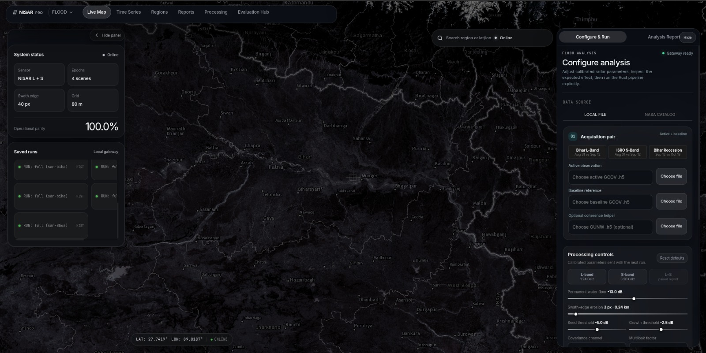
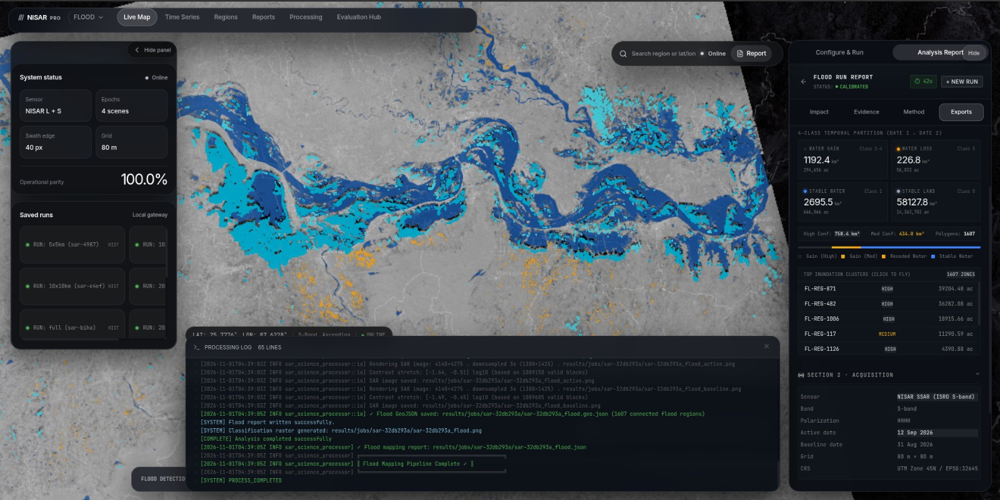

# NISAR Pro

NISAR Pro is an open-source, local-first platform for processing and explaining
NISAR Earth-observation data. It combines a memory-efficient Rust science
engine, a local Axum gateway, and a geospatial React dashboard so researchers
can move from a large satellite product to inspectable maps, reports, and
reproducible analysis.

It is not only a Bihar flood demo. Bihar is one documented case study used to
demonstrate the platform's L-band, S-band, temporal-change, and fusion
capabilities.

**Get it:** [Windows installer](https://github.com/AdityaNarayanNayak-2/NISAR_PRO/releases/latest/download/NISAR-Pro-Setup-1.0.0.exe) ·
[Linux package](#linux) · [Build from source](#build-from-source) · [Try the web demo](https://main.nisar-pro.pages.dev/)

## Where this project comes from

I have been building NISAR Pro for about two years. It started as an
infrastructure project: watching bridges and dams for ground movement with
InSAR. That was the main goal for about six months. The results were not good
enough to publish, so in June 2026 I paused that part and moved to surface
water and flood mapping, where NISAR's L-band and S-band could be tested on
real data. The Bihar study for IEEE InGARSS 2026 came out of that work. The
InSAR code is still in the repository, but treat it as experimental.

<div align="center">

[](LICENSE)
[](https://www.rust-lang.org/)
[](https://nisar.jpl.nasa.gov/)
[](https://ingarss2026.org/)
[](https://main.nisar-pro.pages.dev/)

[Live Dashboard](https://main.nisar-pro.pages.dev/) ·
[Architecture](Docs/Architecture/) ·
[User Guides](Docs/UserGuide/) ·
[IEEE InGARSS 2026 Package](ingarss_2026/)

</div>

---

## What NISAR Pro is for

NISAR Pro is built for engineers, remote-sensing researchers, and teams who
need to process large NISAR products on infrastructure they control.

The platform focuses on four things:

- **Efficient ingestion** of large HDF5-based NISAR products without loading an
  entire scene into memory.
- **Explainable SAR processing** with visible parameters, intermediate
  telemetry, and geospatial outputs instead of opaque black-box results.
- **Local execution and data sovereignty** so raw granules can remain on the
  operator's workstation or internal server.
- **A reusable platform** for GCOV surface-water analysis, L/S comparison,
  temporal change detection, and InSAR/infrastructure workflows.



## Platform capabilities

### NISAR product access and ingestion

- NASA ASF / Earthdata catalogue integration for supported NISAR products.
- Local HDF5 product selection for offline or controlled environments.
- Instrument and band identification from product metadata.
- Coordinate, footprint, acquisition-date, CRS, and channel inspection.
- Windowed and row-strip reading for products that are too large for naive
  in-memory workflows.

### Rust science engine

The `sar_science_processor` crate contains the computational core. Current
processing modules include:

- GCOV backscatter and covariance-channel handling.
- L-band and S-band product support where the selected product metadata
  provides the required channels.
- Block multilooking and calibrated linear-power to dB conversion.
- Speckle filtering, nodata protection, swath-edge conditioning, and memory
  guards.
- Log-ratio change detection, adaptive thresholding, seeded region growing,
  morphology, and connected-component filtering.
- InSAR building blocks including coregistration, coherence, phase filtering,
  unwrapping, deramping, and deformation-oriented outputs (experimental,
  paused since June 2026).
- GeoTIFF, PNG, GeoJSON, and JSON report generation.

### Local gateway

The Axum gateway is the operational boundary around the processor. It provides:

- Local job creation and supervision.
- Server-Sent Events for live processing progress.
- Local result history and artifact discovery.
- NASA catalogue/search proxy functions.
- Safe subprocess execution of the science processor.
- Static serving of the built dashboard on port `3000`.

### Geospatial dashboard

The React/Leaflet dashboard provides a visual workspace for:

- Side-by-side or layered inspection of flood rasters and vector masks.
- Scene footprints, baseline vs. event comparison, and timeline scrubbers.
- Inundation summaries, persistence metrics, and area accounting.
- Interactive threshold adjustments with immediate preview where supported.
- InSAR deformation inspection with point-level coherence and displacement
  (experimental).
- JSON report inspection and artifact downloads.

### InGARSS 2026 case study: Bihar flood lifecycle

The repository preserves the documented 2026 Bihar monsoon flood case study
developed for the IEEE InGARSS 2026 Young Professionals Hackathon:

- Full-scene dual-epoch L-band flood mapping (2026-08-31 to 2026-09-12).
- S-band comparison for the same acquisition window.
- Common-support L+S comparison and cross-frequency agreement.
- Post-monsoon recession observation through 2026-10-18.
- Independent validation workflow against public high-resolution references.
- Offline and reproducible deliverables in `ingarss_2026/`.



## Architecture overview

```text
               ┌──────────────────────────────────────────────────┐
               │              Web Browser / Dashboard             │
               │         React 19 · Leaflet · Vite · UI           │
               └─────────────────────────┬────────────────────────┘
                                         │ HTTP / SSE (Port 3000)
                                         ▼
               ┌──────────────────────────────────────────────────┐
               │                 Local SAR Gateway                │
               │          Rust Axum · Supervisor · Proxies        │
               └──────────────┬───────────────────┬───────────────┘
                              │                   │
               Spawns CLI jobs│                   │ Proxies search
                              ▼                   ▼
    ┌───────────────────────────────┐   ┌──────────────────────────┐
    │     sar_science_processor     │   │ NASA ASF / CMR Search    │
    │  Pure Rust · SIMD · HDF5/GCOV │   │ Remote granule discovery │
    └──────────────┬────────────────┘   └──────────────────────────┘
                   │
                   ▼
    ┌───────────────────────────────┐
    │       Output Artifacts        │
    │ GeoTIFF · GeoJSON · JSON · PNG│
    └───────────────────────────────┘
```

See [Docs/Architecture/](Docs/Architecture/) for deep-dive pipeline descriptions,
data flows, and telemetry formats.

## Demonstration media

The project includes illustrative visual and video assets:

- [Platform dashboard overview](Docs/assets/Dashboard.jpeg)
- [System architecture diagram](Docs/assets/architecture_overview.svg)
- [Demonstration walkthrough video](Docs/assets/nisar-s-band-demo.mp4)
- [Example analysis output](Docs/assets/output.jpeg)

These assets demonstrate the workflow without requiring large data downloads
convenient for reports and presentations.

## Install and run

NISAR Pro runs on your own computer. The app starts a small local server and
opens the dashboard in your browser at `http://localhost:3000`. Your NISAR files
stay on your machine. The installed app needs no Rust, Node.js or Python.

### Windows

1. Download [NISAR-Pro-Setup-1.0.0.exe](https://github.com/AdityaNarayanNayak-2/NISAR_PRO/releases/latest/download/NISAR-Pro-Setup-1.0.0.exe).
2. Run it. No admin rights are needed.
3. Start "NISAR Pro" from the Start Menu. The dashboard opens in your browser.
4. To close it, use "Stop NISAR Pro" from the Start Menu.

Windows may show "Windows protected your PC" because the installer is not
code-signed. Click "More info", then "Run anyway".

If you don't want to install anything, download
[NISAR-Pro-1.0.0-windows-x64-portable.zip](https://github.com/AdityaNarayanNayak-2/NISAR_PRO/releases/latest/download/NISAR-Pro-1.0.0-windows-x64-portable.zip),
extract it and double-click `NISAR Pro.exe`.

### Linux

Tested on RHEL 10. It needs glibc 2.39 or newer, so RHEL 10, Fedora 40+,
Ubuntu 24.04+ or Debian 13. Older systems (RHEL 9, Ubuntu 22.04) should
[build from source](#build-from-source).

One command installs it into your home folder (no `sudo`):

```bash
curl -fsSL https://gitlab.com/api/v4/projects/76194026/packages/generic/nisar-pro/latest/install.sh | bash
nisar-pro
```

If `nisar-pro` is not found, add `~/.local/bin` to your PATH:
`echo 'export PATH="$HOME/.local/bin:$PATH"' >> ~/.bashrc`, then open a new terminal.

Or do it by hand without installing:

```bash
curl -fLO https://github.com/AdityaNarayanNayak-2/NISAR_PRO/releases/latest/download/NISAR-Pro-1.0.0-linux-x86_64.tar.gz
tar -xzf NISAR-Pro-1.0.0-linux-x86_64.tar.gz
cd NISAR-Pro-1.0.0-linux-x86_64
./nisar-pro
```

Press Ctrl+C in the terminal to stop it. Logs are in `sar-gateway/logs/gateway.log`.

### First steps in the dashboard

- **Search** NISAR products in the ASF catalogue. Searching needs no account.
- **Download** needs a free [NASA Earthdata](https://urs.earthdata.nasa.gov/)
  account. Create a token on that site and start the app with
  `EARTHDATA_TOKEN=<your token> nisar-pro`. On Windows, add `EARTHDATA_TOKEN`
  as a user environment variable (Start → "Edit environment variables for
  your account"), then start NISAR Pro.
- **Or use a local file**: pick an `.h5` GCOV product already on your disk.
- Run a job and watch the live log. Results (GeoTIFF, GeoJSON, PNG, JSON) are
  saved in `sar-gateway/results`.

A full L-band scene is about 7 GB and an S-band scene about 12.6 GB, so keep
enough free disk. 8 GB RAM is enough: one pair of full scenes peaks at about
2.3 GB.

### Common problems

| What you see | What to do |
|---|---|
| "port 3000 is in use" or the gateway exits at once | Another program (or an old NISAR Pro) uses port 3000. Close it, or on Linux run `ss -ltnp \| grep :3000` to find it. |
| Linux: `GLIBC_2.39 not found` | Your system is older than the package. Build from source. |
| Browser does not open | Open `http://localhost:3000` yourself. |
| Download fails with 401 | The Earthdata token is missing or expired. Make a new one. |

## Build from source

You need Git, the [Rust toolchain](https://rustup.rs/) (stable) and Node.js 20+.

RHEL / Fedora:

```bash
sudo dnf install -y git gcc pkgconf-pkg-config nodejs npm
curl --proto '=https' --tlsv1.2 -sSf https://sh.rustup.rs | sh
```

Ubuntu / Debian: `sudo apt install -y git build-essential pkg-config nodejs npm`,
then the same `rustup` line. Windows: install Rust from rustup.rs, Node.js 20
LTS and Git, then follow the [Windows local run guide](Docs/UserGuide/windows-local-run.md).

Build and start:

```bash
git clone https://gitlab.com/Aditya-Narayan-Nayak/nisar_pro.git
cd nisar_pro

cargo build --release --manifest-path sar_science_processor/Cargo.toml
cargo build --release --manifest-path sar-gateway/Cargo.toml

cd sar-dashboard-v3 && npm ci && npm run build && cd ..

cd sar-gateway
LOCAL_MODE=true ./target/release/sar-gateway
```

Open `http://localhost:3000`. The gateway serves the built dashboard and starts
the science engine for each job, so there is nothing else to run.

The first Rust build takes a few minutes. To work on the dashboard with live
reload, keep the gateway running and in another terminal run
`cd sar-dashboard-v3 && npm run dev`, then open `http://localhost:5173`.

Run the engine tests with `cd sar_science_processor && cargo test`.

### Use the engine without the dashboard

The science engine is a normal command-line program. The exact commands for
the Bihar runs are in [ingarss_2026/README.md](ingarss_2026/README.md), Step 3.
Run `./sar_science_processor/target/release/sar_science_processor --help` to see
all options.

## Repository layout

```text
sar_analyzer/
├── sar_science_processor/        Pure-Rust compute engine (GCOV flood, GUNW InSAR, 8x8 multilook)
│   ├── src/
│   │   ├── flood_detect.rs       7-stage flood detection & region growing
│   │   ├── nisar_parser.rs       Streaming HDF5 reader & coordinate extraction
│   │   ├── multilook.rs          SIMD block-multilooking
│   │   └── windowed.rs           Zero-copy row-strip reader
│   └── Cargo.toml
├── sar-gateway/                  Async Axum HTTP/SSE gateway, job supervisor & DAAC clients
├── sar-dashboard-v3/             React 19 + Leaflet + Vite interactive web application
├── installer/                    Windows launcher and Linux launcher/installer
├── ingarss_2026/                 Official IEEE InGARSS 2026 submission artifacts
│   ├── results/                  Full-scene GeoTIFF, JSON and GeoJSON outputs
│   └── provenance_manifest.json  SHA-256 integrity and execution provenance
├── scripts/                      Utility scripts
│   └── nisar_probe.py
├── results/                      Generated GeoTIFFs, telemetry JSONs, and PNG figures
├── Docs/                         Comprehensive user & architecture documentation
│   ├── Architecture/             System internals, pipeline diagrams, API specifications
│   └── UserGuide/                Step-by-step setup, Windows runbook, InSAR verification
└── benchmarks/                   Automated 12-benchmark performance validation suite
```

## Reproducibility and scientific boundaries

NISAR Pro records the selected product IDs, dates, channels, CRS, resolution,
thresholds, and output paths in reports where available. The processing
documentation distinguishes:

- measured outputs from interpretation;
- common-support comparisons from standalone runs;
- full-scene results from reference-box inspection;
- quantitative validation from qualitative assessment.

When independent reference labels are unavailable, the project does not invent
accuracy scores. The likely effects of temporal mismatch, viewing geometry,
vegetation, rough soil, wind-roughened water, mixed pixels, and nodata are
reported as uncertainty instead.

## Documentation

- [Architecture documentation](Docs/Architecture/)
- [Flood detection pipeline](Docs/Architecture/flood_detection_pipeline.md)
- [Gateway orchestration](Docs/Architecture/gateway_orchestration.md)
- [Frontend architecture](Docs/Architecture/frontend-dashboard-architecture.md)
- [Windows local run guide](Docs/UserGuide/windows-local-run.md)
- [Release packaging guide](Docs/UserGuide/release-packaging.md)
- [API reference](Docs/UserGuide/api-reference.md)
- [InGARSS 2026 submission package](ingarss_2026/)

## Roadmap

- Return to bridge and dam monitoring with InSAR once the method is reliable.
- An Earthdata login screen in the dashboard, so no environment variable is
  needed for downloads.
- Broader NISAR product coverage and validated metadata adapters.
- More complete polarimetric feature inventories by acquisition mode.
- Quantitative reference-label validation workflows.
- Native Linux package formats (`.deb` and `.rpm`) after the portable package
  is stable.
- Additional local and hosted collaboration workflows without moving raw
  granules off the operator's machine.

## Citation

```bibtex
@software{nisar_pro_2026,
  author = {Nayak, Aditya Narayan},
  title = {NISAR Pro: Open-source local-first processing and analysis for NISAR Earth-observation products},
  year = {2026},
  publisher = {GitHub},
  url = {https://github.com/AdityaNarayanNayak-2/NISAR_PRO}
}
```

## License

Distributed under the Apache-2.0 or MIT License. See [LICENSE](LICENSE).
