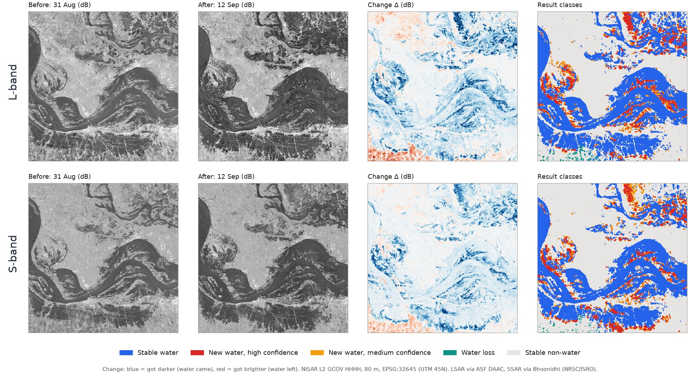
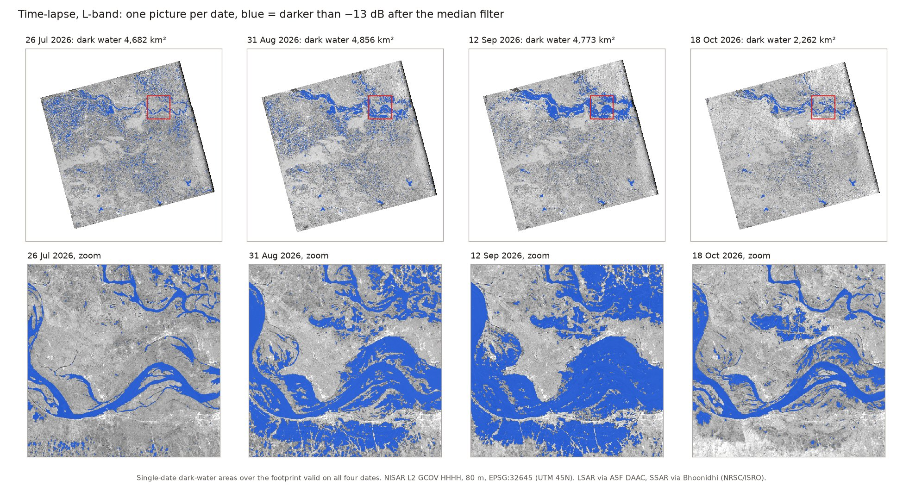

# Dynamic Surface-Water Mapping and Multi-Frequency L + S SAR Fusion over the Bihar Ganga Alluvial Plain Using Memory-Bounded Rust Processing

Aditya Narayan Nayak (Team RunLayer Labs)
NISAR Pro Systems & SAR Analytics, Kundura, Odisha, India
https://gitlab.com/Aditya-Narayan-Nayak/nisar_pro

## Abstract

Surface-water mapping in Bihar during the southwest monsoon cannot rely on optical satellites, because
when we look at the land from the sky, most of the time we see only cloud. Synthetic Aperture Radar
(SAR) sees through cloud, so it is the best way to get imagery and information from the ground. We
present a memory-bounded Rust tool (NISAR Pro) that maps surface-water change from NISAR Level-2
Geocoded Polarimetric Covariance (GCOV) data without exhausting workstation memory. In this work we asked
one simple question: if we combine NISAR L-band and S-band, do we get a better water map than using only
one band? We ran it on the full track 98, frame 14 scene, not just a small box, and compared the three maps
on the common L/S grid, where both bands are valid on both dates (59,083.56 km², 14,599,867 acres). Between 31 August and 12 September 2026, L-band found 1,137.14 km² (280,993 acres) of new water,
S-band found 1,174.89 km² (290,322 acres) and L+S found 1,337.15 km² (330,417 acres). Then we checked all
three against Sentinel-2 optical images taken about five hours after the 12 September pass, wherever there
was no cloud. The F1 score was 0.859 for L-band, 0.891 for S-band and 0.891 for L+S. So combining the
bands made L-band better, but it did not beat S-band. With four L-band dates we could also follow the
water near the river as it spread out and then went back.

Index Terms: NISAR, L-band, S-band, GCOV, change detection, surface water, data fusion, Rust.

## Data

For L-band, we searched NASA's Alaska Satellite Facility (ASF) [5] for NISAR GCOV products over the
20 km × 20 km reference box centred at 25.5° N, 86.5° E. We chose ascending track 98, frame 14, for four
dates: 26 July, 31 August, 12 September and 18 October 2026. These L-band granules (1.239 GHz) are
dual-polarized (DHDH mode), with the HH and HV channels stored as the HHHH and HVHV terms. For S-band
(3.2 GHz), we used ISRO's Bhoonidhi portal [6], which returned two granules in DHNA mode for 31 August and
12 September. Both bands were acquired on the same track, frame and dates, within seconds of each other,
so the L-only, S-only and L+S comparison is fair in time and geometry.

The L-band grid is 33,696 × 34,344 pixels and the S-band grid is 33,120 × 34,200 pixels, both at 10 m
spacing in UTM zone 45N (EPSG:32645). Sentinel-2 Level-2A optical scenes from 29 August,
13 September and 18 October 2026 [7] were used only as independent reference data.

## Memory-Bounded Reading (Step 0)

Each L-band granule spans 33,696 × 34,344 pixels, which is 1,157,255,424 (about 1.16 billion) pixels.
Each pixel is an f32 value (4 bytes), so one polarization is about 4.6 GB.

Now the interesting story. If we open the image with a standard HDF5 library using one single line,
`dataset.read_f32()`, all 4.6 GB go into RAM at once. Comparing two dates means almost 10 GB of RAM before
any intermediate buffer, and on many workstations this ends in an Out-Of-Memory (OOM) error and a freeze.

How we solved this issue: the images are stored in compressed (gzip) chunks of 512 × 512 pixels, so a
program can read only the part it needs. `parse_nisar_full_scene_multilooked()` in `nisar_parser.rs`
reads the image in horizontal strips of 1,024 rows, 33 strips per layer. As each strip arrives, every
8 × 8 block of 10 m pixels is averaged into one 80 m pixel, using only pixels with power of at least
0.0001 and only if at least 32 of the 64 are valid:

> P̄ = (1/n) · Σ Pᵢ,   Pᵢ ≥ 0.0001,   n ≥ 32

The strip is then removed from memory before the next one is read. This results in a grid of
4,212 × 4,293 pixels at 80 m, only 72 MB instead of 4.63 GB. On a 4-core, 15 GB workstation, each pair of
dates (2.31 billion samples) runs in 44–65 seconds with a peak memory of 1.87–2.32 GB. Ponds and
channels narrower than about 80 m are lost.

## The 7-Stage L-Band Method

Calm water acts like a mirror: it reflects the radar pulse away from the satellite, so water looks dark,
while rough land and vegetation look bright [1]. So we compare the same place on two dates and look for
places that became much darker. The Rust functions are in `flood_detect.rs`. Fig. 1 shows every stage on
one 40 km window.

**Stage 1: check the pair and set the numbers.** Both dates must use the same polarization term (HHHH)
and the same product type (GCOV). We checked this by hand.
Then `--radar-band l` or `s` picks the thresholds in `FloodDetectionOptions::for_band()` (Table I).

Table: Band settings used by the engine.

| Setting | L-band | S-band |
|---|---:|---:|
| Wavelength | 24.2 cm | 9.4 cm |
| Stable water (both dates) | −13.0 dB | −12.5 dB |
| Seed change | −5.0 dB | −4.8 dB |
| Growth change | −2.5 dB | −2.2 dB |
| Minimum change limit | −3.0 dB | −2.7 dB |
| Otsu (reported only) | −3.26 dB | −3.47 dB |

**Stage 2: convert to decibels and cut the edge.** `gcov_to_db()` puts the power on a log scale:

> σ⁰ (dB) = 10 · log₁₀(P̄)

Power below 0.0001 (−40 dB) is treated as no data,
and a pixel must be valid on both dates. Then `erode_swath_boundary()` shrinks the valid area 40 pixels
(3.2 km) inward from every no-data edge, because values roll off near the swath edge and would look like
false water.

**Stage 3: clean the speckle.** Radar images have grainy noise called speckle. `median_filter_3x3()`
sorts the valid values in each 3 × 3 window and keeps the middle one, on both dates:

> dB′(r, c) = median of the valid dB in its 3 × 3 window

**Stage 4: find the change.** For every valid pixel, `compute_change_image()` takes:

> Δ = dB′(after) − dB′(before) = 10 · log₁₀(P_after / P_before)

So Δ is the log of the power ratio [4], and anything that stays the same on both dates, like slope or
calibration, cancels out.

**Stage 5: find stable water.** A pixel is stable water if
dB′(before) < −13.0 dB and dB′(after) < −13.0 dB (`build_permanent_water_mask()`). These pixels are kept
out of the next stages, because water that was already there is not new water and would bias the
threshold.

**Stage 6: choose thresholds and grow new water.** First Otsu [2] (`otsu_threshold()`). We take Δ for
valid pixels that are not stable water, keep only −25 dB ≤ Δ ≤ 0 dB, and make a histogram with 256 bins.
For every possible split k, the pixels below k form group 0 and the rest group 1, with shares ω₀, ω₁ and
means μ₀, μ₁. Otsu picks the k with the largest between-group variance:

> σ²_B(k) = ω₀ · ω₁ · (μ₀ − μ₁)²

For L-band this gave −3.26 dB and for S-band −3.47 dB. We also set a minimum change limit of −3.0 dB, so
that a weak split can never seed new water:

> T_seed = min(−5.0, T_Otsu, −3.0) = −5.0 dB

So in these scenes Otsu did not change the map; it is reported only. Now the region growing
(`region_grow()`). Every pixel with Δ < −5.0 dB is a seed. From each seed we check its 8 neighbours, and a
neighbour joins if Δ < −2.5 dB. We repeat until nothing new joins. Why two thresholds? One strict
threshold misses the edges of new water, and one loose threshold picks up noise everywhere. With two, a
weak pixel only counts if it touches a strong one.

Then `morphological_cleanup()` does a 3 × 3 opening. This removes single noisy pixels and thin lines, but
it also removes new water narrower than 3 pixels (about 240 m). Last, any connected group smaller than
8 pixels (0.0512 km², 12.65 acres) is removed.

**Stage 7: give each pixel one class and count.** `compute_confidence()` gives class 1 to stable water,
class 2 (high confidence) to new water with Δ < −5.0 dB and class 3 (medium confidence) to the rest of the
grown new water. If a pixel is none of these, but dB′(before) < −13.0 dB, dB′(after) ≥ −13.0 dB and
Δ ≥ +3.0 dB, it is class 5 (water loss). Everything else is class 0. Class 4 is only used when an InSAR
coherence layer is given, which was not the case here. Then the area is just counting:

> A_km² = N · 0.0064
> A_acres = A_km² / 0.004046856

## 31 August → 12 September: L-Band and S-Band

This is the one pair where we have both bands. Areas here are on each run's own
valid area; from the fusion section on, all three maps share one footprint.

L-band found 1,166.21 km² (288,177 acres) of new water, 3,355.07 km² (829,056 acres) of stable water and
889.96 km² (219,914 acres) of water loss. In the 40 km river window (top row of Fig. 2) the new water
fills the gaps between the channels and the edges of the water bodies.

For S-band we did not build a new pipeline. The same Rust engine runs the same 7 stages; only
`--radar-band s` changes, and with it the thresholds in Table I.

S-band found 1,174.89 km² (290,322 acres) of new water, 2,577.39 km² (636,887 acres) of stable water and
only 217.17 km² (53,664 acres) of water loss. Near the river the two bands nearly agree, and the bottom
row of Fig. 2 shows almost the same shapes. The big difference is away from the river. L-band sees many small dark patches over the west of the scene
that get brighter between the dates, so it reports four times more water loss. Which band is right about those patches is what
the fusion and the Sentinel-2 check try to answer.

## L + S Fusion

We let each band do what it is good at. Both class maps sit on the same 80 m grid: both grids, and the
720 m and 2,880 m shift between them, are exact multiples of 80 m, so every L pixel falls exactly on an
S pixel (4,140 × 4,275 pixels) and we need no resampling. From here on all three maps are compared on
this common footprint of 59,083.56 km² (14,599,867 acres). Then each pixel goes through four simple
if/then rules, so anyone can check every decision. The code is `run_ls_fusion_and_pol_assessment.py` in
`scripts/`.

1. **Sandbar rule (removes false water).** If L-band HH is below −13 dB but S-band HH is −10.5 dB or
   brighter on either date, it is not stable water. Smooth ground can look dark like water to the long L
   wave but rough and bright to the short S wave.
2. **Wind rule (adds water).** If L-band HH is below −15.5 dB and HV below −22.0 dB on both dates, it is
   stable water even when S-band did not mark it, because small wind waves disturb the short S wave more
   than the long L wave. The sandbar rule still wins.
3. **Canopy rule (adds possible water under plants).** If L-band HH drops by at least 3.26 dB, with later
   HV below −20 dB and later HH below −12 dB, the pixel becomes a new-water candidate. The idea is that the
   long L wave goes through crops better than S, but optical data cannot see under plants, so this rule is
   not proven.
4. **S-band gate (main filter).** Every new-water candidate, from L, from S or from the canopy rule, is
   kept only if S-band HH on 12 September is below −10.5 dB.

Water loss needs either band to say loss and L-band to rise by at least 3 dB.

Because candidates come from both bands, the L+S area is partly bigger by design. So to see what each rule
really does, we switched each one off and ran again. The S-band gate is the strongest control:
it removed 338.70 km² (83,695 acres) of candidates. The canopy rule adds 223.53 km² (55,236 acres) of new
water and the wind rule adds 270.51 km² (66,844 acres) of stable water.

Table: The three maps on the common footprint, 31 Aug → 12 Sep 2026.

| | L-band | S-band | L+S |
|---|---:|---:|---:|
| Stable water | 3,314.83 km² (819,112 ac) | 2,546.37 km² (629,222 ac) | 2,652.29 km² (655,395 ac) |
| New water | 1,137.14 km² (280,993 ac) | 1,174.89 km² (290,322 ac) | 1,337.15 km² (330,417 ac) |
| Water loss | 888.84 km² (219,637 ac) | 214.98 km² (53,123 ac) | 723.37 km² (178,749 ac) |
| Water on 12 Sep | 4,451.97 km² (1,100,105 ac) | 3,721.26 km² (919,544 ac) | 3,989.43 km² (985,811 ac) |

L-band and S-band new water overlap by 858.56 km²
(212,155 acres), a Jaccard index of 0.59: the two bands agree on the main pattern but not on the details.

## Four Dates: What Two Could Not Show

S-band exists only for 31 August and 12 September, so fusion, like any single pair, sees one 12-day step.
We also have L-band on 26 July and 18 October, so we ran the same engine on the pairs before and after
(Table III) and made one water picture per date (Fig. 3).

Table: L-band pairs, each on its own valid area.

| Pair | New water | Water loss |
|---|---:|---:|
| 26 Jul → 31 Aug | 1,695.81 km² (419,043 ac) | 1,471.24 km² (363,553 ac) |
| 31 Aug → 12 Sep | 1,166.21 km² (288,177 ac) | 889.96 km² (219,914 ac) |
| 12 Sep → 18 Oct | 239.60 km² (59,207 ac) | 2,551.94 km² (630,597 ac) |

Counting dark water (below −13 dB after the median filter, same footprint on all dates) makes the season
clear. Over the whole scene it was 4,682 km² (1,156,896 acres) on 26 July, 4,856 km² (1,200,020 acres) on
31 August, 4,773 km² (1,179,372 acres) on 12 September and 2,262 km² (558,915 acres) on 18 October. In the
40 km river window it was 213, 617, 812 and 299 km² (52,609, 152,400, 200,608 and 73,872 acres).

This tells us three things one pair could not. First, where the water rose: the whole-scene total barely
moved from July to September, which alone reads as "no change", but the river window nearly quadrupled.
Second, when the peak was: from 31 August → 12 September alone we cannot say if water was still rising or
about to fall; with July before and October after, the window was fullest on 12 September and about half
of all dark water was gone by 18 October. Third, what is really new: 1,282.78 km² (316,982 acres) of the
L+S new water lies outside any water seen on 26 July or 31 August. This is what the problem statement calls
potential temporary surface inundation, and we need the July date to find it. SAR alone does not tell us
why it appeared.

## How We Checked It

We used Sentinel-2 as an independent check (10 m bands averaged to 80 m): a pixel is water if NDWI ≥ 0 [3].
We fixed this threshold before scoring, and we only scored pixels with no cloud, shadow or missing
data inside the NISAR footprint. Every such pixel was scored, with no sampling (Table IV; P = precision, R = recall).

Table: Agreement with Sentinel-2 water on cloud-free pixels (optical labels, not ground truth).

| Test and scored area | Map | P | R | F1 |
|---|---|---:|---:|---:|
| Water, 12 Sep (S-2 5 h later), 7,946.03 km² (1,963,507 ac) | L | 0.826 | 0.895 | 0.859 |
| | S | 0.911 | 0.872 | 0.891 |
| | L+S | 0.900 | 0.881 | 0.891 |
| Water, 31 Aug (S-2 2.8 days earlier), 3,580.03 km² (884,645 ac) | L | 0.730 | 0.902 | 0.807 |
| | S | 0.885 | 0.864 | 0.874 |
| | L+S | 0.801 | 0.869 | 0.834 |
| New water, 31 Aug → 12 Sep, 952.55 km² (235,380 ac) | L | 0.692 | 0.464 | 0.555 |
| | S | 0.714 | 0.600 | 0.652 |
| | L+S | 0.734 | 0.562 | 0.637 |

Confusion matrices are in
`VALIDATION.md`. So L+S beat L-band in every test, mainly because it made fewer false alarms (higher
precision), but it did not beat S-band.

**Checking the sandbar rule.** Then we asked: those pixels that are dark for L-band but bright for S-band,
what are they really? In cloud-free Sentinel-2, only 8.7% of them were water on 12 September (107.60 km²,
26,589 acres scored) and 9.2% on 31 August (74.38 km², 18,380 acres), against 80.3% and 70.3% where both
bands were dark. So S-band was right to flag them. But they were not all sand: bare ground led on
31 August (56.8%) and vegetation led on 12 September (63.2%).

**Polarization.** HH separated stable water from land better than HV in both bands (separability 4.28
against 3.30 for L, 4.94 against 3.40 for S). Scored against Sentinel-2 on 12 September, L-band HH alone
gave F1 0.848, adding an HV test gave 0.835 and the span HH + 2·HV gave 0.854, so HV added little here.
Details: `POLARIZATION_ASSESSMENT.md`.

## How to Reproduce

Quick check, with plain Python 3 and no granules: `python3 run_bihar_analysis.py` checks every packaged
file against its SHA-256 hash, prints every number in this note by task (A–H) and ends with
`ALL CHECKS PASSED`. When we reran
everything on 7–10 November 2026, we got exactly the same areas, and a clean rebuild of the engine from
source gave a byte-identical binary.

## Limits

Cloud means we could score only about 14% of the footprint on 12 September. Our fusion thresholds are hand-set: moving the S-band gate by ±1 dB
moves new water between 1,208.44 and 1,449.29 km² (298,611 to 358,128 acres). New water means a drop in
backscatter, not an absolute water test, and 97.94 km² (24,201 acres) of fused new water stays above both
water thresholds on the later date. "Stable water" means water on two dates, not permanent water, and we make no claim about what
caused any change.

## Conclusion

So, does L+S help? Compared with L-band alone, yes: it removed much of L-band's over-mapping and gave the
best precision for new water (0.734). Compared with S-band alone, no, not in these tests. Whether L-band
really finds water under plants is still open, because our optical check cannot see it. The four L-band
dates showed what one pair cannot: the water spread along the river until at least 12 September and about
half of it was gone by 18 October. Next we want labels under vegetation, better thresholds, more L+S dates
and the L-band full-polarimetric data on track 120. And the whole workflow runs on the full scene in about
2 GB of memory, with code, settings and file hashes included, so anyone can check our numbers.

## References

[1] P. A. Rosen et al., "The NASA-ISRO SAR mission dual-band radar instrument preliminary design," in Proc. IEEE IGARSS, 2017.
[2] N. Otsu, "A threshold selection method from gray-level histograms," IEEE Trans. Syst., Man, Cybern., vol. 9, no. 1, pp. 62–66, 1979.
[3] S. K. McFeeters, "The use of the normalized difference water index (NDWI) in the delineation of open water features," Int. J. Remote Sens., vol. 17, no. 7, pp. 1425–1432, 1996.
[4] L. Giustarini et al., "A change detection approach to flood mapping in urban areas using TerraSAR-X," IEEE Trans. Geosci. Remote Sens., vol. 51, no. 4, pp. 2417–2430, 2013.
[5] Alaska Satellite Facility, NISAR data search, https://search.asf.alaska.edu/
[6] NRSC/ISRO, Bhoonidhi NISAR data, https://bhoonidhi.nrsc.gov.in/NISAR/
[7] Microsoft Planetary Computer, Sentinel-2 Level-2A, https://planetarycomputer.microsoft.com/dataset/sentinel-2-l2a
[8] Software: Rust (rustyhdf5, ndarray, Rayon, tiff); Python (NumPy, h5py, rasterio, matplotlib).
